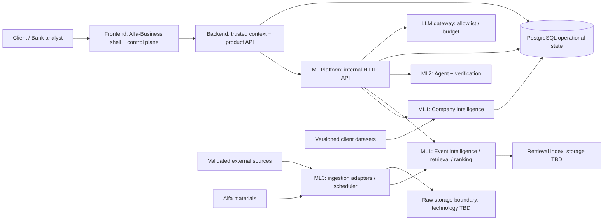

# System design

Status: DRAFT, 2026-10-22. Реестр классификаций: [D/Q](../planning/decision-register.md). Логические компоненты не означают отдельные микросервисы.

## Context и boundaries

TEAM DECISION D01/D11: monorepo; Frontend → Backend → ML по HTTP/JSON; Python/FastAPI/Pydantic для ML; operational PostgreSQL. Frontend/backend stack, vector storage, raw storage, cache и transport lifecycle остаются TBD.

ASSUMPTION: один deployable ML service с логическими модулями и управляемым исполнением ingestion/analysis jobs достаточен как стартовая topology. Отдельный процесс worker допустим только после выбора lifecycle и измерения ресурсоёмкости; не подразумеваются broker или очередь конкретной технологии.

## Ownership и контракт

| Boundary | Владелец | Обязанности | Не делает |
|---|---|---|---|
| Frontend | FE owner | Client/admin surfaces, состояния, API mocks, доступные evidence | Не назначает scope/role, не вызывает LLM напрямую |
| Backend | BE owner | Trusted request context, resource access checks, public API, conversations/feedback orchestration | Не импортирует Python functions и не дублирует ML ranking |
| Company Intelligence | ML1 | EDA, profile snapshots, group provenance, graph hypotheses | Не выводит права доступа из graph |
| Event Intelligence / Retrieval | ML1 | Article→Event, semantic dedup, indexing/ranking, EvidencePackage | Не выдаёт внешнюю новость за позицию банка |
| Agent | ML2 | План/инструменты, grounded generation, verification/adaptation, follow-up | Не выполняет финансовые операции; не раскрывает hidden reasoning |
| ML Platform | ML3 | HTTP API, gateway, budget, bounded retries, ingestion infra, trace/metrics, configs, health | Не выбирает graph/retrieval quality policy без ML1/ML2 |
| PostgreSQL | BE + ML3 по ownership сущностей | Product state и ML state, ограничения/transactions | Не shared write-anywhere boundary |

ASSUMPTION: Backend owns User-facing Insight resource, Conversation/Message/Feedback и admin request validation; ML owns generated Insight content, profiles/events/evidence и execution traces; ML3 owns source ingestion state. Единственный writer каждой сущности/поля и транзакционные границы подтвердить вместе с physical schema (Q14). Прямые cross-module записи запрещать на уровне согласованного repository/API boundary; общая PostgreSQL не разрешает FE доступ к БД.

## Потоки данных

1. Client import сохраняет исходные ключи и snapshot; ML1 строит versioned CompanyProfile. Group profile сохраняет вклад участников. Refresh/rebuild триггер — Q09; news polling к CSV не относится.
2. ML3 загружает raw material через Source adapter, нормализует и делает technical dedup; ML1 сопоставляет публикации событиям, индексирует news и Alfa material. Reprocessing не требует повторной загрузки raw.
3. Backend проверяет выбранный context, разрешённую роль и передаёт trusted analysis context ML. Feed получает ranking + lightweight explanations, не дорогой full analysis всего списка.
4. Открытие карточки создаёт запрос анализа. ML2 получает EvidencePackage, вызывает tools, формирует claims, проверяет и при необходимости повторяет retrieval. Snapshot refs возвращаются вместе с AgentResponse. Backend сохраняет/выдаёт разрешённый результат.
5. Conversation связана с Insight и исходным context/role/profile. Новый question может расширить evidence, но не подменяет scope. История сохраняется; LLM context window policy Q13.
6. Trace, analytics и operational metrics коррелируют запрос/response по trace_id; client получает только разрешённую проекцию.

## Sync / async

TEAM DECISION: expensive generation on demand. TBD Q07: sync, async или hybrid. [RFC 0002](../rfc/0002-insight-generation-lifecycle.md) сравнивает варианты; два response shapes в API — альтернативы для обсуждения, не автоматический выбор hybrid.

ASSUMPTION: generation имеет логическую state machine `QUEUED → RUNNING → SUCCEEDED | INSUFFICIENT_EVIDENCE | FAILED`; sync реализация может не публиковать промежуточные состояния, но trace фиксирует execution. HTTP 202 и polling status resource становятся обязательными только при принятом async/hybrid варианте.

ASSUMPTION: generation request idempotency boundary включает requester context/role, Event, Profile snapshot, config version и idempotency key. Это защита от повторной оплаты, не бессрочное переиспользование финальных персональных ответов между пользователями. Конкурентные запросы и retry semantics требуют contract review.

## Failure boundaries

| Сбой | Поведение | Восстановление |
|---|---|---|
| Один source недоступен | DEGRADED, сохранённый corpus остаётся; остальные adapters продолжают | Bounded retry/backoff, manual sync |
| Raw сохранён, metadata не записана | Не публиковать неполную Article version | Idempotent reconciliation; механизм после выбора storage |
| Index отстаёт | Feed использует последнюю согласованную index/profile version и обозначает freshness | Reindex/reprocess, не смешивать embeddings разных моделей |
| Профиль не готов | Отдельный state; не generic аналитика под видом персональной | Rebuild по управляемому триггеру |
| Нет Alfa evidence / conflicting facts | Честное ограничение/расхождение; повторный retrieval | Partial analysis с явно обозначенными допущениями |
| LLM timeout, malformed JSON, budget exhausted | Trace причины, контролируемый retry, понятная ошибка | Validation, лимиты попыток и токенов TBD; не бесконечный цикл |
| Backend retry / duplicate message | Не двойной платный запуск/agent response | Idempotency и optimistic state checks; details review |
| Analytics sink недоступен | Не подменять успешный Insight ошибкой telemetry | Учёт потерь/повторная доставка TBD; critical audit persistence отдельно |
| PostgreSQL недоступен | Не выдавать несохранённый результат как воспроизводимый | Fail safely, recovery после availability |

## Security boundaries

CASE REQUIREMENT C16 + TEAM D12: Q01 открыт. Не фиксируются OAuth/JWT/cookie/session API и формула grants. Все продуктовые операции conceptually protected, internal ML доступен только доверенному Backend/Platform. До решения Q01 эти спецификации нельзя выставлять как анонимный production API.

Обязательные свойства: backend проверяет scope на каждой загрузке feed/insight/conversation/source/trace, роль не берётся из client body, group membership не означает access. User role ≠ admin capability; конфигурация source и внутренняя trace доступны по отдельным разрешениям, политика TBD.

ASSUMPTION: least-privilege tools allowlist; news/PDF/user text трактуются как недоверенные данные, их инструкции не меняют system/tool policy. Инструменты анализа read-only; Source Admin writes вне agent toolset. Для fetch source configs нужны scheme/host validation, запрет localhost/private metadata endpoints и проверка redirect targets (SSRF boundary), конкретная network policy review с ML3. Tool results и messages имеют размеры/timeout limits TBD. Доступ к raw files через проверенный backend boundary; secrets только env/secret references, без logging/response. Analytics содержит минимум pseudonymous refs. Hidden chain-of-thought не сохраняется/не раскрывается.

## Deployment view

TEAM DECISION: воспроизводимый Docker startup с frontend, backend, ML, PostgreSQL; extra runtime dependencies только с justification. Версии/lock-файлы, env docs, healthchecks и synthetic seed создаются при реализации. Raw и index adapters выбираются отдельно; S3/Redis/Qdrant не подразумеваются наличием диаграммы.

ASSUMPTION: liveness отличается от readiness: сервис жив, но profile/index/model gateway может быть не готов. ML health отдаёт только безопасные statuses без credentials. Exact orchestration commands, ports, images и external host TBD вместе со stacks.

## Tradeoffs и release gates

Предварительные schema RFC требуют отдельной сверки с semantic model. Два OpenAPI приняты как boundary, но schemas/paths остаются предложениями initial design. Сначала согласовать общие DTO и Q01/Q07/Q14, затем параллельная реализация. Перед demo проверить budget guardrails, input/role isolation, failure recovery, новые события и version provenance.

## Риски реализации

| Риск | Мера снижения / ответственная граница |
|---|---|
| Заявленный объём не завершён в срок хакатона | Сначала сквозной сценарий с ключевыми boundaries, затем расширение corpus/roles; изменение scope согласуется командой |
| Предварительная схема БД воспринимается как принятая | Сверить final mapping с semantic model и API до migrations |
| Утечка данных между Group, dialogue или trace | Закрыть Q01, использовать trusted context и negative access tests; graph relations не означают доступ |
| Персональные выводы не подтверждены данными | Claim-feature-source links, экспертная проверка и bounded verification/adaptation |
| Платёжных данных недостаточно для business assumptions | EDA units/period/coverage; не выводить договоры или задолженность из факта платежа |
| Precompute или agent loops исчерпывают бюджет | Lightweight previews, reuse промежуточных результатов, bounded calls, shared usage accounting |
| AI-вывод ошибочно приписан банку | ALFA_ANALYTICS только с dated evidence; отсутствие позиции или расхождение явно обозначается |
| Контракты расходятся между компонентами | Shared schemas, совместный contract review и versioned config |
| Задержка генерации нарушает пользовательский сценарий | Benchmark Q07 до contract freeze; состояния loading/failure/insufficient evidence |
| Качество зависит от заранее подготовленных событий | Held-out Event families и ingestion нового материала в demo |

## Этапы реализации

1. Согласовать semantic glossary, PRD, DTO и mapping со схемой БД; определить владельцев API/model, закрыть Q01 и выбрать frontend/backend stacks.
2. Провести client/corpus EDA, подготовить labeled evaluation subset, измерить extraction/generation baseline. Проверить provider allowlist/budget и HTTP integration; frontend использует mocks согласованной части API.
3. По измерениям выбрать generation lifecycle, raw storage и initial retrieval/index approach; обновить RFC/ADR и контракты. Согласовать physical data mapping до migrations.
4. Собрать первый E2E: source → Event → Profile → feed → on-demand Insight → Claim/Evidence → conversation, включая trace, error handling и access checks.
5. Добавить graph features с измеренной пользой, Company/Group/role contrasts, feedback, alerts по согласованной policy, Source Management и Quality UI.
6. Выполнить held-out/failure/security checks, замеры качества/стоимости, воспроизводимый Docker startup и [release checklist](../demo/demo-evaluation.md#финальная-сдача-case-requirement-с-8).

## Распределение ответственности

ASSUMPTION: план параллельной работы пяти разработчиков; владельцы и handoffs подтверждаются командой.

| Направление | Первые работы | Handoff |
|---|---|---|
| Frontend | Shell entry, context selection, feed/Insight/conversation/control-plane mocks и states | Public API, feedback и safe trace projection |
| Backend | Resource/access model, API orchestration, persistence mapping, conversations/feedback | Public ↔ internal API, Q01/Q14 |
| ML1 | Company Intelligence: EDA, profiles, group/payment context, eval labels | CompanyProfile/FeatureRef/EvidencePackage |
| ML2 | Сначала Event Intelligence совместно с ML1: Article → Event/index baseline; затем agent/generation | EvidencePackage → AgentResponse/Claim verification |
| ML3 | Ingestion/registry/gateway/budget/trace, internal API и integration harness | NormalizedArticle, execution/errors |

После совместного retrieval baseline ML1 продолжает retrieval/ranking/evaluation, ML2 фокусируется на агенте и генерации. Число владельцев не требует отдельного сетевого сервиса для каждого направления.

## Готовность к реализации

Initial design находится на review. FE mocks можно строить по DRAFT schemas; реализация защищённых операций, generation lifecycle и хранения требует закрыть Q01/Q07/Q14 и принять затронутые контракты. EDA и ML experiments выполняются независимо на синтетических scoped fixtures. Перед merge согласованной схемы обязательна сверка semantic model, DTO и physical mapping.
