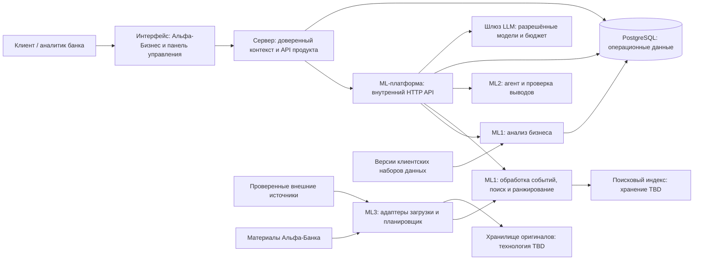

# Архитектура системы

Статус: DRAFT, 2026-10-22. Классификация решений: [реестр D/Q](../planning/decision-register.md). Логический компонент не обязательно является отдельным микросервисом.

## Контекст и границы компонентов

TEAM DECISION D01/D11: единый репозиторий; интерфейс → серверная часть → ML-сервис по HTTP/JSON; Python/FastAPI/Pydantic для ML; PostgreSQL для операционных данных. Технологии интерфейса и сервера, векторное хранилище, хранение оригиналов, кэш и порядок получения результата остаются TBD.

ASSUMPTION: для начального развёртывания достаточно одного ML-сервиса с логическими модулями и управляемым выполнением задач загрузки и анализа. Отдельный процесс обработки задач допустим после выбора порядка выполнения и измерения ресурсоёмкости; брокер сообщений и конкретная технология очереди не предполагаются.

## Ответственность и контракты

| Компонент | Владелец | Обязанности | За пределами ответственности |
|---|---|---|---|
| Интерфейс (Frontend) | Разработчик интерфейса | Клиентские и административные экраны, состояния, имитации API, доступные основания выводов | Не назначает контекст доступа и роль, не вызывает LLM напрямую |
| Серверная часть (Backend) | Серверный разработчик | Доверенный контекст запроса, проверка доступа к ресурсам, внешний API, работа с диалогами и обратной связью | Не импортирует внутренние функции Python и не дублирует ML-ранжирование |
| Анализ бизнеса | ML1 | Исследование данных (EDA), версии профилей, происхождение групповых признаков, гипотезы по графу связей | Не выводит права доступа из графа |
| Обработка событий и поиск | ML1 | Публикации → события, смысловая дедупликация, индексирование и ранжирование, `EvidencePackage` | Не выдаёт внешнюю новость за позицию банка |
| Агент | ML2 | Планирование и инструменты, генерация с подтверждениями, проверка и уточнение анализа, ответы на вопросы | Не выполняет финансовые операции и не раскрывает скрытые рассуждения модели |
| ML-платформа | ML3 | HTTP API, шлюз моделей, бюджет, ограниченные повторы, загрузка источников, трассировка и метрики, конфигурация, состояние сервисов | Не выбирает методы работы с графом и критерии качества поиска без ML1/ML2 |
| PostgreSQL | Серверный разработчик и ML3 по владельцам сущностей | Данные продукта и ML, ограничения и транзакции | Не предоставляет всем компонентам неограниченную запись |

ASSUMPTION: сервер владеет пользовательским ресурсом `Insight`, сущностями `Conversation`/`Message`/`Feedback` и проверкой административных запросов. ML владеет сгенерированным содержимым разбора, профилями, событиями, доказательствами и трассировкой выполнения; ML3 — состоянием загрузки источников. Единственного владельца записи каждой сущности или поля и границы транзакций необходимо подтвердить вместе с физической схемой (Q14). Прямые записи в данные другого модуля ограничиваются согласованными слоями доступа к данным и API; общая PostgreSQL не даёт интерфейсу доступ к БД.

## Потоки данных

1. При импорте клиентских данных сохраняются исходные ключи и версия набора; ML1 строит версионируемый `CompanyProfile`. Профиль группы сохраняет вклад участников. Причина и способ обновления или перестроения — Q09; опрос новостных источников не относится к обновлению CSV.
2. ML3 загружает оригинал через адаптер источника, нормализует его и устраняет технические дубли. ML1 сопоставляет публикации событиям и индексирует новости и материалы Альфы. Повторная обработка не требует повторной загрузки оригинала.
3. Сервер проверяет выбранный контекст и разрешённую роль, затем передаёт ML доверенные параметры анализа. Для ленты возвращаются ранжирование и краткие объяснения, без полного дорогого анализа всего списка.
4. Открытие карточки создаёт запрос анализа. ML2 получает `EvidencePackage`, вызывает инструменты, формирует утверждения, проверяет их и при необходимости повторяет поиск. Ссылки на использованные версии возвращаются в `AgentResponse`; сервер сохраняет и выдаёт разрешённый результат.
5. Диалог `Conversation` связан с `Insight` и исходными контекстом, ролью и профилем. Новый вопрос может потребовать дополнительных доказательств, но не меняет границы анализа. История сохраняется; правила объёма истории в контексте LLM — Q13.
6. Трассировка, аналитика и операционные метрики связывают запрос и ответ по `trace_id`; клиенту доступна только разрешённая часть сведений.

## Синхронное и асинхронное выполнение

TEAM DECISION: полный дорогой анализ выполняется по запросу. TBD Q07: синхронный, асинхронный либо гибридный вариант. [RFC 0002](../rfc/0002-insight-generation-lifecycle.md) сравнивает варианты; две формы ответа в API — альтернативы для обсуждения, а не уже выбранный гибрид.

ASSUMPTION: генерация имеет логическую последовательность состояний `QUEUED → RUNNING → SUCCEEDED | INSUFFICIENT_EVIDENCE | FAILED`. Синхронная реализация может не показывать промежуточные состояния наружу, но трассировка фиксирует выполнение. HTTP 202 и опрос отдельного ресурса состояния обязательны только при принятом асинхронном или гибридном варианте.

ASSUMPTION: защита запроса генерации от повторного выполнения учитывает контекст и роль пользователя, событие, версию профиля, версию конфигурации и ключ идемпотентности. Это предотвращает повторную оплату одного запроса, но не разрешает бессрочно переиспользовать финальные персональные ответы между пользователями. Параллельные запросы и поведение при повторе требуют согласования контракта.

## Изоляция сбоев и восстановление

| Сбой | Поведение | Восстановление |
|---|---|---|
| Один источник недоступен | Состояние DEGRADED, накопленные материалы сохраняются; остальные адаптеры продолжают работу | Ограниченные повторы с увеличением интервала, ручная синхронизация |
| Оригинал сохранён, метаданные не записаны | Неполная версия публикации не публикуется | Идемпотентная сверка и восстановление; механизм зависит от выбранного хранилища |
| Индекс отстаёт | Лента использует последнюю согласованную версию индекса и профиля и сообщает об актуальности | Переиндексация или повторная обработка; векторы разных моделей не смешиваются |
| Профиль не готов | Отдельное состояние; общая аналитика не выдаётся за персональную | Перестроение по управляемому сигналу |
| Нет аналитики Альфы или факты противоречат друг другу | Явное ограничение или расхождение, дополнительный поиск | Частичный анализ с обозначенными допущениями |
| Превышено время ожидания LLM, некорректный JSON или исчерпан бюджет | Причина в трассировке, контролируемый повтор, понятная ошибка | Проверка результата; лимиты попыток и токенов TBD, без бесконечного цикла |
| Повтор запроса сервера или дублирующее сообщение | Нет двойного платного запуска и дублирующего ответа агента | Идемпотентность и оптимистическая проверка состояния; детали требуют согласования |
| Хранилище аналитических событий недоступно | Успешный разбор не подменяется ошибкой телеметрии | Учёт потерь и повторная доставка TBD; сохранение критичного аудита рассматривается отдельно |
| PostgreSQL недоступен | Несохранённый результат не выдаётся как воспроизводимый | Безопасное завершение с ошибкой, восстановление после возврата доступности |

## Границы безопасности

CASE REQUIREMENT C16 + TEAM DECISION D12: Q01 открыт. Не выбраны OAuth/JWT/cookie, API сессий и правила предоставления прав. Все продуктовые операции требуют защиты; внутренний ML доступен только доверенной серверной части и платформе. До решения Q01 спецификации нельзя выставлять как анонимный API для эксплуатации.

Обязательные свойства: сервер проверяет доступ при каждом чтении ленты, разбора, диалога, источника и трассировки. Роль не берётся из тела клиентского запроса; принадлежность компании к группе не даёт доступ ко всей группе. Бизнес-роль пользователя не равна административным полномочиям; конфигурация источника и внутренняя трассировка доступны по отдельным разрешениям, правила пока TBD.

ASSUMPTION: инструменты ограничены разрешённым перечнем и минимальными правами. Новости, PDF и пользовательский текст — недоверенные данные; инструкции в них не меняют правила системы и инструментов. Инструменты анализа работают только на чтение; административные изменения источников не входят в набор инструментов агента. Для загрузки источников проверяются схема и адрес узла, запрещаются localhost и внутренние адреса метаданных, проверяются цели перенаправлений (защита от SSRF); конкретная сетевая политика согласуется с ML3. Ограничения размера результатов инструментов и сообщений, а также времени ожидания — TBD. Доступ к оригиналам идёт через проверенную серверную границу; секреты передаются только через окружение или ссылки на хранилище секретов, не попадают в журналы и ответы. Аналитика содержит минимум псевдонимных ссылок. Скрытые цепочки рассуждений модели не сохраняются и не раскрываются.

## Развёртывание

TEAM DECISION: воспроизводимый запуск Docker для интерфейса, сервера, ML и PostgreSQL; каждая дополнительная зависимость времени выполнения требует обоснования. Версии, lock-файлы, описание окружения, проверки состояния и начальные синтетические данные готовятся при реализации. Адаптеры хранения оригиналов и индекса выбираются отдельно; диаграмма не означает обязательного использования S3, Redis или Qdrant.

ASSUMPTION: проверка работоспособности процесса отличается от проверки готовности обслуживать запросы: сервис может быть запущен, но профиль, индекс или шлюз моделей ещё не готовы. Проверки ML возвращают только безопасные состояния без учётных данных. Команды запуска, порты, образы и внешний сервер остаются TBD вместе с выбором технологий.

## Компромиссы и условия готовности

Предварительные RFC схемы требуют отдельной сверки с предметной моделью. Два OpenAPI приняты как граница взаимодействия, но схемы и пути остаются проектными предложениями. Сначала согласуются общие DTO и Q01/Q07/Q14, затем начинается параллельная реализация. Перед демонстрацией проверяются бюджетные ограничения, изоляция входных данных и ролей, восстановление после ошибок, новые события и происхождение версий.

## Риски реализации

| Риск | Мера снижения / ответственная граница |
|---|---|
| Заявленный объём не завершён в срок хакатона | Сначала полный сценарий с ключевыми границами компонентов, затем расширение набора материалов и ролей; изменение объёма согласуется командой |
| Предварительная схема БД воспринимается как принятая | Сверить окончательное соответствие схемы предметной модели и API до миграций |
| Утечка данных между группами, диалогами или трассировками | Закрыть Q01, использовать доверенный контекст и проверки запрещённого доступа; граф связей не даёт прав |
| Персональные выводы не подтверждены данными | Связи «утверждение — признак — источник», экспертная проверка и ограниченное число повторных проверок и уточнений |
| Платёжных данных недостаточно для выводов о бизнесе | Исследовать единицы, период и покрытие; не выводить договоры или задолженность из факта платежа |
| Предварительные расчёты или циклы агента исчерпывают бюджет | Краткие карточки, переиспользование промежуточных результатов, ограниченные вызовы и общий учёт расходов |
| Вывод ИИ ошибочно приписан банку | ALFA_ANALYTICS только с датированными доказательствами; отсутствие позиции или расхождение явно обозначается |
| Контракты расходятся между компонентами | Общие схемы, совместное согласование контрактов и версии конфигурации |
| Задержка генерации нарушает пользовательский сценарий | Измерения Q07 до утверждения контрактов; состояния ожидания, ошибки и нехватки подтверждений |
| Качество зависит от заранее подготовленных событий | Отложенные группы связанных событий и загрузка нового материала в демонстрации |

## Этапы реализации

1. Согласовать словарь предметной области, PRD, DTO и их соответствие схеме БД; определить владельцев API и модели, закрыть Q01 и выбрать технологии интерфейса и сервера.
2. Исследовать клиентские данные и материалы, подготовить размеченную оценочную выборку, измерить базовое качество извлечения фактов и генерации. Проверить разрешённые модели провайдера, бюджет и HTTP-взаимодействие; интерфейс использует имитации согласованной части API.
3. По измерениям выбрать порядок выполнения генерации, хранение оригиналов и начальный способ поиска и индексирования; обновить RFC/ADR и контракты. Согласовать физическое представление данных до миграций.
4. Собрать первый полный сценарий: источник → событие → профиль → лента → разбор по запросу → утверждения и доказательства → диалог, включая трассировку, обработку ошибок и проверки доступа.
5. Добавить признаки графа с измеренной пользой, сравнение компаний, групп и ролей, обратную связь, предупреждения по согласованным правилам, управление источниками и контроль качества.
6. Проверить отложенные данные, сбои и безопасность, измерить качество и стоимость, обеспечить воспроизводимый запуск Docker и выполнить [список требований к сдаче](../demo/demo-evaluation.md#финальная-сдача-case-requirement-с-8).

## Распределение ответственности

ASSUMPTION: план параллельной работы пяти разработчиков; владельцы и результаты передачи между направлениями подтверждаются командой.

| Направление | Первые работы | Результат для других компонентов |
|---|---|---|
| Интерфейс | Точка входа, выбор контекста, имитации ленты, разбора, диалога и панели управления, состояния экранов | Внешний API, обратная связь и безопасное представление трассировки |
| Серверная часть | Модель ресурсов и доступа, координация API, соответствие хранилищу, диалоги и обратная связь | Внешний ↔ внутренний API, Q01/Q14 |
| ML1 | Анализ бизнеса: EDA, профили, контекст групп и платежей, разметка для оценки | CompanyProfile / FeatureRef / EvidencePackage |
| ML2 | Сначала обработка событий совместно с ML1: публикация → событие и базовый индекс; затем агент и генерация | EvidencePackage → AgentResponse / проверка Claim |
| ML3 | Загрузка, реестр источников, шлюз моделей, бюджет, трассировка, внутренний API и средства интеграционной проверки | NormalizedArticle, выполнение и ошибки |

После совместной подготовки базового поиска ML1 продолжает поиск, ранжирование и оценку качества; ML2 фокусируется на агенте и генерации. Число владельцев не требует отдельного сетевого сервиса для каждого направления.

## Готовность к реализации

Проект находится на рассмотрении команды. Имитации интерфейса можно строить по схемам DRAFT; реализация защищённых операций, порядка выполнения генерации и хранения требует закрыть Q01/Q07/Q14 и принять затронутые контракты. Исследование данных и ML-эксперименты выполняются независимо на синтетических данных с явно заданными контекстами. Перед объединением согласованной схемы обязательна сверка предметной модели, DTO и физического представления.
