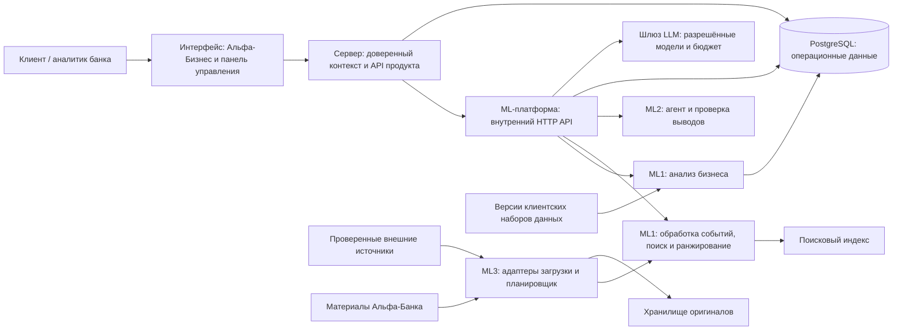

# Архитектура системы

Система объединяет обработку новостей, бизнес-контекст клиента и многошаговый анализ. Архитектура разделяет ответственность компонентов и сохраняет единые контракты, чтобы интерфейс, сервер и ML можно было разрабатывать независимо. Логический компонент не обязательно развёртывается отдельным микросервисом.

## Контекст и границы компонентов

Проект организован в одном репозитории. Пользовательский интерфейс обращается к серверу, сервер — к ML-сервису по HTTP/JSON. ML использует Python, FastAPI и Pydantic; операционные данные хранятся в PostgreSQL.

Сервер отвечает за пользовательские ресурсы и доступ, ML — за обработку контекста, поиск и аналитические выводы. Хранение оригиналов, поисковый индекс и кэш отделены интерфейсами: их технологическая реализация не меняет смысл бизнес-контекста, доказательств и ответа.

Начальная схема развёртывания объединяет ML-модули в сервис с управляемым выполнением загрузки и анализа. Фоновая обработка может выноситься в отдельный процесс, когда это оправдано длительностью и нагрузкой. Такая граница не требует автоматически вводить брокер сообщений или отдельную очередь.

## Ответственность и контракты

| Компонент | Владелец | Обязанности | За пределами ответственности |
|---|---|---|---|
| Интерфейс (Frontend) | Разработчик интерфейса | Клиентские и административные экраны, состояния, имитации API, доступные основания выводов | Не назначает контекст доступа и роль, не вызывает LLM напрямую |
| Серверная часть (Backend) | Серверный разработчик | Доверенный контекст запроса, проверка доступа к ресурсам, внешний API, работа с диалогами и обратной связью | Не импортирует внутренние функции Python и не дублирует ML-ранжирование |
| Анализ бизнеса | ML1 | Исследование данных (EDA), версии профилей, происхождение групповых признаков, гипотезы по графу связей | Не выводит права доступа из графа |
| Обработка событий и поиск | ML1 | Публикации → события, смысловая дедупликация, индексирование и ранжирование, `EvidencePackage` | Не выдаёт внешнюю новость за позицию банка |
| Агент | ML2 | Планирование и инструменты, генерация с подтверждениями, проверка и уточнение анализа, ответы на вопросы | Не выполняет финансовые операции и не раскрывает скрытые рассуждения модели |
| ML-платформа | ML3 | HTTP API, шлюз моделей, бюджет, ограниченные повторы, загрузка источников, трассировка и метрики, конфигурация, состояние сервисов | Не выбирает методы работы с графом и критерии качества поиска без ML1/ML2 |
| PostgreSQL | Серверный разработчик и ML3 по владельцам сущностей | Данные продукта и ML, ограничения и транзакции | Не предоставляет всем компонентам неограниченную запись |

Сервер владеет пользовательским ресурсом `Insight`, диалогами, сообщениями, обратной связью и проверкой административных запросов. ML отвечает за аналитическое содержимое разбора, профили, события, доказательства и трассировку; ML3 — за загрузку источников.

У каждой сущности и изменяемого поля определяется один владелец записи. Транзакции и слой доступа к данным поддерживают эту границу: наличие общей PostgreSQL не даёт модулю право произвольно изменять чужие данные, а интерфейсу — обращаться к БД напрямую.

## Потоки данных

1. При импорте клиентских данных сохраняются исходные ключи и версия набора; ML1 строит версионируемый `CompanyProfile`. Профиль группы сохраняет вклад участников. Обновление профиля связано с поступлением новой версии клиентских данных; расписание новостей не применяется к CSV.
2. ML3 загружает оригинал через адаптер источника, нормализует его и устраняет технические дубли. ML1 сопоставляет публикации событиям и индексирует новости и материалы Альфы. Повторная обработка не требует повторной загрузки оригинала.
3. Сервер проверяет выбранный контекст и разрешённую роль, затем передаёт ML доверенные параметры анализа. Для ленты возвращаются ранжирование и краткие объяснения, без полного дорогого анализа всего списка.
4. Открытие карточки создаёт запрос анализа. ML2 получает `EvidencePackage`, вызывает инструменты, формирует утверждения, проверяет их и при необходимости повторяет поиск. Ссылки на использованные версии возвращаются в `AgentResponse`; сервер сохраняет и выдаёт разрешённый результат.
5. Диалог `Conversation` связан с `Insight` и исходными контекстом, ролью и профилем. Новый вопрос может потребовать дополнительных доказательств, но не меняет границы анализа. История сохраняется; объём истории в запросе к LLM ограничивается доступным контекстом и бюджетом, при этом полная разрешённая история остаётся сохранённой.
6. Трассировка, аналитика и операционные метрики связывают запрос и ответ по `trace_id`; клиенту доступна только разрешённая часть сведений.

## Синхронное и асинхронное выполнение

Полный анализ выполняется при открытии события. Краткая лента готовится отдельно, поэтому просмотр списка не запускает дорогую генерацию для каждой карточки.

API описывает два способа доставки: готовый ответ в исходном HTTP-запросе и принятие задачи с последующим чтением состояния. Они поддерживают разные условия задержки. Синхронный способ подходит, когда вся цепочка укладывается в ограничения соединения; асинхронный позволяет продолжить долгую обработку после закрытия страницы. Подробное сравнение приведено в [разборе генерации](../rfc/0002-insight-generation-lifecycle.md).

Генерация имеет логическую последовательность состояний `QUEUED → RUNNING → SUCCEEDED | INSUFFICIENT_EVIDENCE | FAILED`. Синхронная реализация может не показывать промежуточные состояния наружу, но трассировка фиксирует выполнение. При асинхронном выполнении ответ HTTP 202 содержит ссылку на операцию; клиент получает результат через её состояние. В синхронном режиме готовый ответ возвращается непосредственно.

Защита запроса генерации от повторного выполнения учитывает контекст и роль пользователя, событие, версию профиля, версию конфигурации и ключ идемпотентности. Это предотвращает повторную оплату одного запроса, но не разрешает бессрочно переиспользовать финальные персональные ответы между пользователями. Повтор с тем же ключом не должен создавать второй платный запуск. Обработка параллельных запросов сохраняет один результат операции и однозначную связь с пользовательским ресурсом.

## Изоляция сбоев и восстановление

| Сбой | Поведение | Восстановление |
|---|---|---|
| Один источник недоступен | Состояние DEGRADED, накопленные материалы сохраняются; остальные адаптеры продолжают работу | Ограниченные повторы с увеличением интервала, ручная синхронизация |
| Оригинал сохранён, метаданные не записаны | Неполная версия публикации не публикуется | Идемпотентная сверка и восстановление; механизм зависит от выбранного хранилища |
| Индекс отстаёт | Лента использует последнюю согласованную версию индекса и профиля и сообщает об актуальности | Переиндексация или повторная обработка; векторы разных моделей не смешиваются |
| Профиль не готов | Отдельное состояние; общая аналитика не выдаётся за персональную | Перестроение по управляемому сигналу |
| Нет аналитики Альфы или факты противоречат друг другу | Явное ограничение или расхождение, дополнительный поиск | Частичный анализ с обозначенными допущениями |
| Превышено время ожидания LLM, некорректный JSON или исчерпан бюджет | Причина в трассировке, контролируемый повтор, понятная ошибка | Проверка результата; лимиты попыток и токенов учитывают общий бюджет, без бесконечного цикла |
| Повтор запроса сервера или дублирующее сообщение | Нет двойного платного запуска и дублирующего ответа агента | Идемпотентность и оптимистическая проверка состояния; сохранение единственного результата при конкурирующих запросах |
| Хранилище аналитических событий недоступно | Успешный разбор не подменяется ошибкой телеметрии | Контроль потерь и повторной доставки; сохранение критичного аудита рассматривается отдельно |
| PostgreSQL недоступен | Несохранённый результат не выдаётся как воспроизводимый | Безопасное завершение с ошибкой, восстановление после возврата доступности |

## Границы безопасности

Сервер получает доверенную идентичность пользователя и проверяет права перед работой с ресурсом. Эти свойства не зависят от способа передачи сессии или токена: клиент не назначает себе роль, а внутренний ML принимает обращения через доверенную серверную границу.

Вход и управление сессиями относятся к механизму доступа. Отсутствие описания входа в продуктовых OpenAPI не означает анонимный доступ к операциям.

Обязательные свойства: сервер проверяет доступ при каждом чтении ленты, разбора, диалога, источника и трассировки. Роль не берётся из тела клиентского запроса; принадлежность компании к группе не даёт доступ ко всей группе. Бизнес-роль пользователя не равна административным полномочиям; конфигурация источника и внутренняя трассировка доступны по отдельным разрешениям, проверка применяется к каждому запросу.

Инструменты ограничены разрешённым перечнем и минимальными правами. Новости, PDF и пользовательский текст — недоверенные данные; инструкции в них не меняют правила системы и инструментов. Инструменты анализа работают только на чтение; административные изменения источников не входят в набор инструментов агента. Для загрузки источников проверяются схема и адрес узла, запрещаются localhost и внутренние адреса метаданных, проверяются цели перенаправлений (защита от SSRF); эти проверки реализуются на границе загрузки, за которую отвечает ML3. Размеры результатов инструментов, сообщений и время ожидания ограничиваются, чтобы единичный запрос не исчерпал ресурсы и бюджет. Доступ к оригиналам идёт через проверенную серверную границу; секреты передаются только через окружение или ссылки на хранилище секретов, не попадают в журналы и ответы. Аналитика содержит минимум псевдонимных ссылок. Скрытые цепочки рассуждений модели не сохраняются и не раскрываются.

## Развёртывание

Воспроизводимый запуск Docker для интерфейса, сервера, ML и PostgreSQL; каждая дополнительная зависимость времени выполнения требует обоснования. Версии, lock-файлы, описание окружения, проверки состояния и начальные синтетические данные готовятся при реализации. Адаптеры хранения оригиналов и индекса выбираются отдельно; диаграмма не означает обязательного использования S3, Redis или Qdrant.

Проверка работоспособности процесса отличается от проверки готовности обслуживать запросы: сервис может быть запущен, но профиль, индекс или шлюз моделей ещё не готовы. Проверки ML возвращают только безопасные состояния без учётных данных. Команды запуска, порты, образы и окружение описываются в конфигурации развёртывания; они должны позволять повторить демонстрационный запуск.

## Согласованность компонентов

Общие DTO связывают предметную модель, внешний и внутренний API. Изменение роли, версии профиля или структуры доказательств отражается во всех затронутых контрактах, а физическая схема поддерживает их инварианты.

Перед демонстрацией проверяются ограничения бюджета, изоляция данных и ролей, восстановление после ошибок, обработка новых событий и происхождение версий. Совместимость компонентов подтверждается интеграционными проверками, а не совпадением названий полей.

## Риски реализации

| Риск | Мера снижения / ответственная граница |
|---|---|
| Заявленный объём не завершён в срок хакатона | Сначала полный сценарий с ключевыми границами компонентов, затем расширение набора материалов и ролей; изменение объёма согласуется командой |
| Физическая схема расходится с предметной моделью | Сверить окончательное соответствие схемы предметной модели и API до миграций |
| Утечка данных между группами, диалогами или трассировками | Использовать матрицу доступа, доверенный контекст и проверки запрещённого доступа; граф связей не даёт прав |
| Персональные выводы не подтверждены данными | Связи «утверждение — признак — источник», экспертная проверка и ограниченное число повторных проверок и уточнений |
| Платёжных данных недостаточно для выводов о бизнесе | Исследовать единицы, период и покрытие; не выводить договоры или задолженность из факта платежа |
| Предварительные расчёты или циклы агента исчерпывают бюджет | Краткие карточки, переиспользование промежуточных результатов, ограниченные вызовы и общий учёт расходов |
| Вывод ИИ ошибочно приписан банку | ALFA_ANALYTICS только с датированными доказательствами; отсутствие позиции или расхождение явно обозначается |
| Контракты расходятся между компонентами | Общие схемы, совместное согласование контрактов и версии конфигурации |
| Задержка генерации нарушает пользовательский сценарий | Измерения полной цепочки обработки; состояния ожидания, ошибки и нехватки подтверждений |
| Качество зависит от заранее подготовленных событий | Отложенные группы связанных событий и загрузка нового материала в демонстрации |

## Этапы реализации

1. Подготовить единый словарь предметной области, PRD, DTO и их соответствие схеме БД; определить владельцев API и модели и реализовать проверяемую границу доступа.
2. Исследовать клиентские данные и материалы, подготовить размеченную оценочную выборку, измерить базовое качество извлечения фактов и генерации. Проверить разрешённые модели провайдера, бюджет и HTTP-взаимодействие; интерфейс использует имитации согласованной части API.
3. По измерениям выбрать порядок выполнения генерации, хранение оригиналов и начальный способ поиска и индексирования; отразить обоснование в архитектурных разборах и контрактах; проверить физическое представление до миграций.
4. Собрать первый полный сценарий: источник → событие → профиль → лента → разбор по запросу → утверждения и доказательства → диалог, включая трассировку, обработку ошибок и проверки доступа.
5. Добавить признаки графа с измеренной пользой, сравнение компаний, групп и ролей, обратную связь, предупреждения по согласованным правилам, управление источниками и контроль качества.
6. Проверить отложенные данные, сбои и безопасность, измерить качество и стоимость, обеспечить Воспроизводимый запуск Docker и выполнить [список требований к сдаче](../demo/demo-evaluation.md#финальная-сдача).

## Распределение ответственности

Работа пяти разработчиков разделена по входам и выходам компонентов. Каждый владелец получает проверяемый контракт и передаёт результат следующему участнику цепочки.

| Направление | Первые работы | Результат для других компонентов |
|---|---|---|
| Интерфейс | Точка входа, выбор контекста, имитации ленты, разбора, диалога и панели управления, состояния экранов | Внешний API, обратная связь и безопасное представление трассировки |
| Серверная часть | Модель ресурсов и доступа, координация API, соответствие хранилищу, диалоги и обратная связь | Внешний ↔ внутренний API, проверка доступа и соответствие БД |
| ML1 | Анализ бизнеса: EDA, профили, контекст групп и платежей, разметка для оценки | CompanyProfile / FeatureRef / EvidencePackage |
| ML2 | Сначала обработка событий совместно с ML1: публикация → событие и базовый индекс; затем агент и генерация | EvidencePackage → AgentResponse / проверка Claim |
| ML3 | Загрузка, реестр источников, шлюз моделей, бюджет, трассировка, внутренний API и средства интеграционной проверки | NormalizedArticle, выполнение и ошибки |

После совместной подготовки базового поиска ML1 продолжает поиск, ранжирование и оценку качества; ML2 фокусируется на агенте и генерации. Число владельцев не требует отдельного сетевого сервиса для каждого направления.

## Проверка совместной работы

Компонент готов к включению в полный сценарий, когда он соблюдает входной и выходной контракт, сохраняет происхождение данных, проверяет доступ и возвращает описанные состояния ошибок. Интерфейсные имитации используют те же схемы, что и сервер, а сервер и ML проверяются совместно на повторных, медленных и ошибочных запросах.

Полный прототип дополнительно подтверждает качество на новых событиях, соответствие физической модели API, контроль расходов и воспроизводимый запуск. Исследование данных и ML-эксперименты используют синтетические наборы с явно заданными контекстами.
