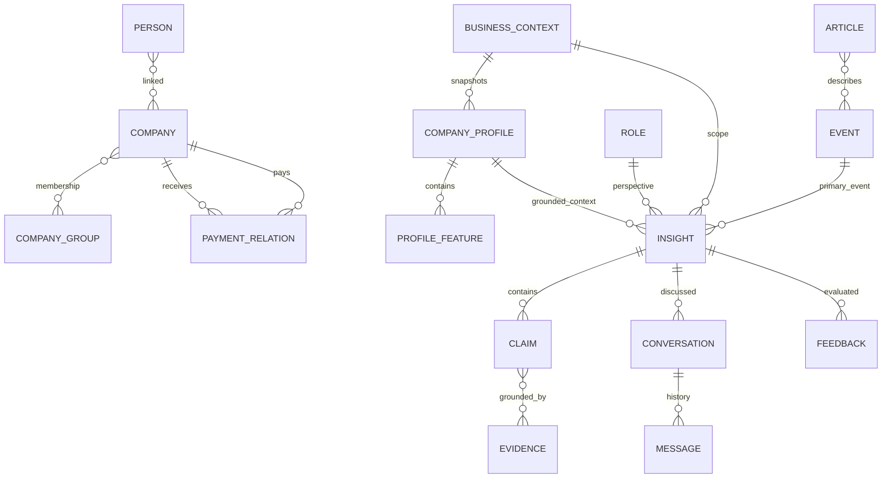

# Semantic data model

Status: DRAFT. TEAM DECISION D02–D05 задают concepts; детали полей/идентификаторов ниже ASSUMPTION D16/D17, требуют review. Это не замена `feature/db-rfc` и не DDL.

## Три слоя

Domain model определяет смысл и invariants. API DTO определяет переносимую JSON-проекцию в [общих схемах](../api/schemas.yaml). Physical model определяет таблицы, индексы, FK/JSONB и migrations после согласования DB RFC. Одна domain entity не обязательно равна одной таблице; API ID не диктует UUID/BIGINT в PostgreSQL.

## Словарь, идентичность и ownership

| Concept | Ответственность / связи | Identity / версия | Предлагаемый owner |
|---|---|---|---|
| User | Пользователь сервиса; может сопоставляться synthetic Person; не сама Person | user_id opaque; auth policy Q01 | Backend |
| Role | Доверенный бизнес-ракурс в выбранном context; не permission | role_id opaque, source trusted | Backend; Q01 |
| Person | Обезличенное лицо исходного dataset | person_id + SYNTHETIC_F | ML1 import |
| Company | Исходное юрлицо и исходные признаки | company_id + SYNTHETIC_U | ML1 import |
| CompanyGroup | Группа с явным membership; не персональная ACL | group_id + исходный GROUP_ID | ML1 import |
| PaymentRelation | Направление payer→beneficiary, сумма/количество; period/currency только если есть | payment relation ref + dataset snapshot | ML1 import |
| BusinessContext | Ровно один scope Company XOR Group | context_id + kind + subject_id | Backend coordinates; ML1 resolves |
| CompanyProfile | Производный snapshot для BusinessContext, переиспользуется между запросами | profile_id + version + dataset/config refs | ML1 |
| ProfileFeature | Значение/единицы/missingness + derivation + contribution компаний | feature_id в immutable profile snapshot | ML1 |
| Source | Registry config, trust class, health; source_role не trust score | source_id | ML3; admin через Backend |
| RawArticle | Сохранённая загрузка original bytes + retrieval metadata | raw ref + checksum | ML3 |
| Article | Конкретная публикация источника; NormalizedArticle её унифицированное представление | article_id; article_version_id для content version | ML3 ingestion + ML1 processing |
| Document / Chunk | Обобщение publication/аналитического файла и его цитируемых фрагментов | document_version_id / chunk_id; raw hashes | ML1/ML3 |
| Event | Реальное событие, несколько Article могут описывать одно | event_id; event revision для изменений | ML1 |
| Evidence | Адресуемое основание утверждения: news/bank/company | evidence_id + точный reference | ML1 supplies; ML2 consumes |
| EvidencePackage | Контекст, snapshot, ranking/retrieval output, доступные evidence и gaps | package_id + trace_id | ML1 |
| Insight | Персональная интерпретация одного primary Event; дополнительные supporting events допустимы | insight_id + revision, context/role/profile pinned | Backend resource / ML2 content |
| Claim | Отдельное существенное утверждение в Insight/agent message | claim_id; owner response revision | ML2 |
| Conversation / Message | Dialogue конкретного User/Insight/context/role; ordered messages, история между сессиями | conversation_id / message_id + sequence | Backend; agent content ML2 |
| Feedback | Оценка полезности конкретного Insight revision, опциональный reason/comment | feedback_id, user/context refs | Backend |
| Alert | Explainable high-impact state для Event/context/role | alert_id + policy version | ML1 policy; Backend resource |
| Trace | Корреляция существенных стадий, не hidden reasoning | trace_id + stage/span refs | ML3, Backend propagation |
| AnalyticsEvent | Product/quality/technical telemetry с минимальным payload | analytics_event_id (не event_id новости) | ML3/Backend ingestion |
| Story | Развивающаяся связь нескольких Events во времени | FUTURE; API/resource не требуется v0.1 | FUTURE ML1 |

## Основные связи

ASSUMPTION: Person-company links сохраняются M:N без вывода должности/ownership; group membership cardinality/temporal semantics проверяются EDA, не объявляются на основании рисунка. BusinessContext хранит kind/subject, не два произвольно nullable scope. Company и Group с одинаковым raw external key не одно и то же.

## CompanyProfile и raw data

TEAM DECISION: CompanyProfile заранее строится и переиспользуется. ASSUMPTION: raw business snapshot role-neutral, role-aware view используется при ranking/generation. Это позволяет CEO/CFO ссылаться на одну фактическую базу, но получать разные объяснения; если потребуется role-derived feature, его derivation/config явно отмечается, не меняя исходные данные.

Каждый значимый feature ссылается на raw dataset snapshot/records, calculation version и конкретные компании для group aggregation. Missing ≠ false ≠ zero. Градация работников сохраняется как градация; точный workers_count без данных не выводится. Валюта/период PAY_AMT и семантика NEGATIVEMARK/REVENUE_COMPANY проверяются до вычислений. Платёжная связь сама по себе не доказывает договор, долг, поставку сырья или зависимость бизнеса; indirect exposure — только валидированная гипотеза.

Версия профиля фиксирует membership snapshot. Aggregated group revenue нельзя считать консолидированной выручкой без методики исключения внутригрупповых оборотов. CompanyGroup access и агрегирование restricted компаний требуют Q01. Не строить «всю группу» из доступной пользователю части, скрывая неполноту.

## Evidence и Claim

TEAM DECISION: Evidence types `EXTERNAL_NEWS`, `ALFA_ANALYTICS`, `COMPANY_DATA`; Claim types `FACT`, `ALFA_ANALYTICS`, `AI_INFERENCE`, `FORECAST`. Verification: `SUPPORTED`, `PARTIALLY_SUPPORTED`, `UNSUPPORTED`.

ASSUMPTION: Evidence имеет typed reference:

- material evidence → source_id, document_version_id, chunk_id и excerpt; publication timestamp nullable, если источник его не даёт;
- company evidence → profile_id/version, feature_id и contributing_company_ids, provenance исходных records;
- ClaimEvidence link → evidence_id + relation `SUPPORT | CONTRADICT | CONTEXT`. Наличие цитаты не равно entailment; статус verification оценивает её применимость к конкретному claim.

У FACT подтверждаются значения, участники и даты. У ALFA_ANALYTICS требуется соответствующий Alfa material, а не внешняя статья с приписыванием банку. У AI_INFERENCE связываются premises (news/company/bank) и раскрываются допущения. У FORECAST дополнительно указываются условность и горизонт, если известен. `SUPPORTED` для прогноза означает поддержанные основания, не гарантию будущего события.

UNSUPPORTED не публикуется как подтверждённый факт; может быть записан во внутренней проверке, а client получает limitation. Для PARTIALLY_SUPPORTED нужны явная оговорка/допущение или дополнительный retrieval. У существенного публикуемого claim не может быть пустого grounding; «мы не нашли данных» оформляется limitation, а не выдуманным factual claim.

## Версии, lifecycle и freshness

ASSUMPTION: Article identity стабильна при обновлении содержимого; новая content version сохраняет hash и timestamp. Evidence из старого Insight не перепривязывается автоматически на последний документ. Точный raw storage Q10, схема версий Q14. Слияние Events сохраняет aliases/provenance и не ломает старые Insight refs; механизм merge/revision предстоит согласовать в physical model.

Insight фиксирует primary_event_id, context, trusted role, profile snapshot, evidence refs, model/config и trace. Новый анализ с изменённым context/profile/role — новая revision/resource согласно итоговому lifecycle; не молчаливая перезапись истории. Preview отдельно от full Insight, поэтому preview ID не требует заранее сгенерированного персонального текста.

Conversation всегда принадлежит конкретному Insight revision и User. Follow-up может добавлять новые material versions; response отмечает использованную актуальность, не переписывая основания старых ответов. Message сохраняет user/assistant status и response claims/evidence; context change — новый scoped flow, не arbitrary body override.

Feedback ссылается на Insight revision. Product feedback и AnalyticsEvent разные записи: feedback является бизнес-данными, telemetry может доставляться повторно и дедуплицируется по analytics_event_id. Поведенческое использование feedback для ranking — FUTURE, не автоматическое online learning.

## Сверка с будущей БД

Перед принятием final schema сверить User/Person separation, CompanyGroup/membership, snapshot profiles/features, role/context dimensions Insight, claim-level evidence, conversations/messages, Feedback, trace linkage и event/document versions. Не выводить обязательный DDL из DTO. Индексы, FK, precision, retention и JSONB boundaries согласуются в schema review; `assessment` из RFC можно сопоставить Insight только после проверки перечисленных измерений.
