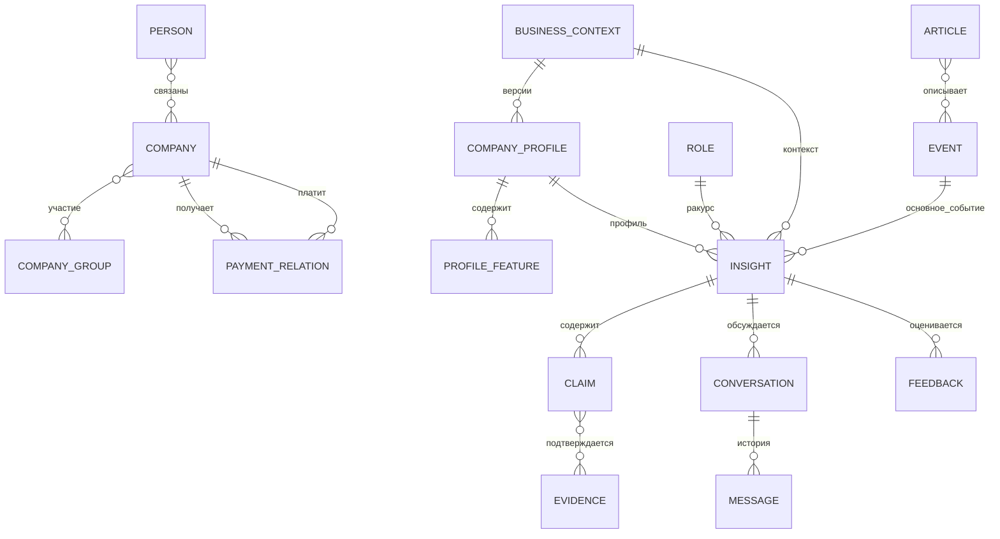

# Предметная модель данных

Модель определяет, что означают сущности системы и какие связи между ними сохраняются от исходных данных до пользовательского ответа. Её задача — обеспечить единый смысл компании, группы, профиля, события и разбора во всех компонентах. Это описание предметной области, а не SQL-схема таблиц.

## Три слоя

Предметная модель определяет смысл сущностей и обязательные правила. Форматы обмена API (DTO) задают JSON-представление в [общих схемах](../api/schemas.yaml). Физическая модель определяет таблицы, индексы, внешние ключи, JSONB и миграции при реализации хранения. Одной сущности не обязательно соответствует одна таблица; идентификатор API не диктует использование UUID или BIGINT в PostgreSQL.

## Словарь, идентификаторы и ответственность

Технические имена сохранены для однозначной связи с API; пояснения определяют их смысл.

| Сущность | Ответственность / связи | Идентификатор / версия | Предлагаемый владелец |
|---|---|---|---|
| Пользователь — `User` | Пользователь сервиса; может сопоставляться синтетическому физлицу, но не равен ему | `user_id` со скрытой внутренней структурой; идентичность проверяет сервер | Сервер |
| Роль — `Role` | Доверенный бизнес-ракурс в выбранном контексте; не право доступа | `role_id`, доверенный источник | Сервер |
| Физическое лицо — `Person` | Обезличенное лицо исходного набора | `person_id` + `SYNTHETIC_F` | Импорт ML1 |
| Компания — `Company` | Исходное юрлицо и его признаки | `company_id` + `SYNTHETIC_U` | Импорт ML1 |
| Группа компаний — `CompanyGroup` | Группа с явным составом участников; не список прав пользователя | `group_id` + исходный `GROUP_ID` | Импорт ML1 |
| Платёжная связь — `PaymentRelation` | Направление плательщик → получатель, сумма и количество; период и валюта только при наличии | Ссылка на связь + версия исходного набора | Импорт ML1 |
| Бизнес-контекст — `BusinessContext` | Ровно один объект анализа: компания либо группа | `context_id` + `kind` + `subject_id` | Сервер координирует, ML1 определяет данные |
| Бизнес-профиль — `CompanyProfile` | Производная версия данных для контекста, переиспользуемая между запросами | `profile_id` + `version` + версии данных и конфигурации | ML1 |
| Признак профиля — `ProfileFeature` | Значение, единицы, сведения о пропусках, способ расчёта и вклад компаний | `feature_id` внутри неизменяемой версии профиля | ML1 |
| Источник — `Source` | Конфигурация реестра, класс доверия, состояние; роль источника не равна численной надёжности | `source_id` | Go: реестр и административный API |
| Оригинал — `RawArticle` | Сохранённые исходные байты и метаданные загрузки | Ссылка на оригинал + контрольная сумма | Go-воркер |
| Публикация — `Article` | Материал конкретного источника; `NormalizedArticle` — его унифицированное представление | `article_id`; `article_version_id` для версии содержимого | Загрузка Go, обработка ML1 |
| Документ / фрагмент — `Document` / `Chunk` | Общее представление публикации или аналитического файла и цитируемых фрагментов | `document_version_id` / `chunk_id`; хеши оригиналов | Go: оригиналы и метаданные; ML1: фрагменты |
| Событие — `Event` | Реальное событие, которое могут описывать несколько публикаций | `event_id`; редакция события при изменениях | ML1 |
| Доказательство — `Evidence` | Адресуемое основание утверждения: новость, материал банка или данные компании | `evidence_id` + точная ссылка | ML1 формирует, ML2 использует |
| Пакет доказательств — `EvidencePackage` | Контекст, версии, результаты поиска и ранжирования, доказательства и пробелы | `package_id` + `trace_id` | ML1 |
| Персональный разбор — `Insight` | Интерпретация одного основного события; допускаются дополнительные связанные события | `insight_id` + редакция; фиксированные контекст, роль и профиль | Сервер — ресурс, ML2 — содержимое |
| Утверждение — `Claim` | Отдельное существенное утверждение в разборе или ответе агента | `claim_id`; принадлежность редакции ответа | ML2 |
| Диалог / сообщение — `Conversation` / `Message` | Диалог пользователя по конкретному разбору, контексту и роли; упорядоченная история между сессиями | `conversation_id` / `message_id` + номер в последовательности | Сервер; текст агента — ML2 |
| Обратная связь — `Feedback` | Оценка конкретной редакции разбора, необязательные причина и комментарий | `feedback_id`, ссылки на пользователя и контекст | Сервер |
| Предупреждение — `Alert` | Объяснимое высокое влияние события для контекста и роли | `alert_id` + версия правил | Правила ML1; ресурс — сервер |
| Трассировка — `Trace` | Связь существенных этапов, без скрытых рассуждений модели | `trace_id` + ссылки на этапы и вложенные операции | ML3; сервер передаёт идентификатор |
| Аналитическое событие — `AnalyticsEvent` | Продуктовая, качественная или техническая телеметрия с минимальным составом данных | `analytics_event_id`, не идентификатор новостного события | ML3 / серверный приём событий |
| Сюжет — `Story` | Связь нескольких событий, развивающаяся во времени | Следующие версии; отдельный API и ресурс в v0.1 не требуются | ML1: следующие версии |

## Основные связи

Связи физлиц и компаний сохраняются как многие-ко-многим без вывода о должности или собственности. Количество возможных групп для компании и изменение состава во времени проверяются EDA, а не устанавливаются рисунком. Бизнес-контекст имеет тип и объект анализа, а не два произвольно пустых поля. Компания и группа с одинаковым исходным ключом не считаются одной сущностью.

## Бизнес-профиль и исходные данные

Профиль является воспроизводимым представлением бизнеса на определённый момент. Он объединяет исходные признаки и расчёты, но сохраняет разницу между известным фактом, отсутствующим значением и производным показателем. Поэтому профиль можно переиспользовать в нескольких запросах и проверять, на какой базе был сформирован каждый разбор.

`CompanyProfile` строится заранее и переиспользуется. Сохранённая фактическая основа профиля не зависит от роли; роль учитывается при ранжировании и генерации. CEO и CFO могут ссылаться на одну базу фактов, получая разные объяснения. Если нужен производный признак для конкретной роли, способ расчёта и конфигурация явно отмечаются, не изменяя исходные данные.

Каждый значимый признак ссылается на версию исходного набора, записи, версию расчёта и конкретные компании при объединении группы. Отсутствие данных не равно `false` или нулю. Градация численности сотрудников сохраняется как градация; точный `workers_count` без данных не выводится. Валюта и период `PAY_AMT`, смысл `NEGATIVEMARK` и `REVENUE_COMPANY` проверяются до вычислений. Платёжная связь сама по себе не доказывает договор, задолженность, поставку сырья или зависимость бизнеса; косвенное влияние — только проверенная гипотеза.

Версия профиля фиксирует состав группы. Суммарная выручка компаний группы не считается консолидированной без методики исключения внутригрупповых оборотов. Доступ к группе и объединение данных компаний подчиняются одной матрице прав; пользователь не должен получать сведения об участнике, к которому у него нет разрешения. Нельзя строить «всю группу» из доступной пользователю части, скрывая неполноту.

## Доказательства и утверждения

Утверждение — отдельная проверяемая мысль: факт события, позиция банка, вывод о последствиях или прогноз. Доказательство — конкретный материал либо признак, на который эта мысль опирается. Такая детализация позволяет пользователю проверять отдельный вывод, а системе — исправлять его без переписывания всего ответа.

Типы доказательств — `EXTERNAL_NEWS` (внешние новости), `ALFA_ANALYTICS` (аналитика банка), `COMPANY_DATA` (данные компании). Типы утверждений — `FACT` (факт), `ALFA_ANALYTICS` (позиция банка), `AI_INFERENCE` (вывод модели), `FORECAST` (прогноз). Результаты проверки: `SUPPORTED`, `PARTIALLY_SUPPORTED`, `UNSUPPORTED` — подтверждено, подтверждено частично, не подтверждено.

Доказательство содержит ссылку соответствующего типа:

- материал → `source_id`, `document_version_id`, `chunk_id` и выдержка; дата публикации может отсутствовать, если её не даёт источник;
- данные компании → `profile_id`/версия, `feature_id`, `contributing_company_ids` и происхождение исходных записей;
- связь утверждения с доказательством → `evidence_id` и отношение `SUPPORT`, `CONTRADICT` или `CONTEXT`: поддержка, противоречие либо контекст. Наличие цитаты не доказывает утверждение; проверяется применимость основания именно к нему.

У факта проверяются значения, участники и даты. Для позиции Альфы требуется соответствующий материал банка, а не внешняя статья с приписыванием банку. Вывод модели связывает предпосылки из новостей, данных компании и аналитики, раскрывая допущения. Прогноз дополнительно обозначает условность и горизонт, если он известен. Статус `SUPPORTED` у прогноза означает подтверждённость оснований, а не гарантию будущего события.

`UNSUPPORTED` не публикуется как подтверждённый факт; он может сохраняться во внутренней проверке, а клиент получает ограничение. Для `PARTIALLY_SUPPORTED` нужны явная оговорка, допущение или дополнительный поиск. У существенного опубликованного утверждения не может быть пустого набора оснований; отсутствие найденных данных оформляется как ограничение, без выдуманного факта.

## Версии, жизненный цикл и актуальность

Идентификатор публикации стабилен при обновлении содержимого; новая версия сохраняет хеш и время. Доказательство старого разбора не перепривязывается автоматически к последнему документу. Ссылка ведёт на конкретную сохранённую версию независимо от используемого хранилища. Объединение событий сохраняет прежние идентификаторы и происхождение данных, не ломая ссылки старых разборов; физическая модель сохраняет эти соответствия, включая прежние идентификаторы и редакции.

Для одной пары `(article_version_id, pipeline_version)` существует одна операция обработки с постоянным `processing_id`. Go сохраняет в задании версию пайплайна и снимок переданных ML метаданных источника. ML хранит идемпотентный ключ, отпечаток входных данных без `trace_id` и отдельные результаты каждой версии пайплайна: `document_version_id`, фрагменты, события и индексные записи. Новая версия пайплайна не изменяет прежний документ и фрагменты; ссылки доказательств старых разборов продолжают разрешаться. Удаление операций и ключей во время хакатона не предусмотрено.

Разбор фиксирует `primary_event_id`, контекст, доверенную роль, версию профиля, ссылки на доказательства, модель, конфигурацию и трассировку. Новый анализ при изменении контекста, профиля или роли создаёт новую редакцию либо ресурс с сохранением связи с предыдущим результатом, без незаметной перезаписи истории. Краткая карточка существует отдельно от полного разбора: её идентификатор не требует заранее сгенерированного персонального текста.

Диалог всегда принадлежит конкретной редакции разбора и пользователю. Уточняющий ответ может добавлять новые версии материалов и указывает использованную актуальность, не переписывая основания старых ответов. Сообщение сохраняет автора, состояние и утверждения с доказательствами ответа; смена контекста запускает новый сценарий, а не произвольную подмену через тело сообщения.

Обратная связь ссылается на редакцию разбора. `Feedback` и `AnalyticsEvent` — разные записи: оценка является данными продукта, телеметрия может доставляться повторно и устраняет дубли по `analytics_event_id`. Поведенческое использование оценок в ранжировании относится к следующим версиям; сама запись оценки не запускает автоматическое обучение.

## Соответствие физической модели

Go хранит серверные сессии, права на контексты и роли, реестр источников и состояние фоновых задач. Идентичность пользователя берётся из проверенной сессии. Контекст для ML формируется Go и передаётся только по аутентифицированной внутренней границе.

Для платного разбора и уточнения хранится операция идемпотентности: пользователь, тип операции, ключ, отпечаток клиентских параметров, зафиксированные контекст и роль, версии профиля и конфигурации, состояние и ссылка на результат. Уникальность пользователя, типа операции и ключа проверяется транзакционно до запуска ML. ML хранит собственную связь стабильного идентификатора операции Go с выполнением. Это семантические требования к хранению, без изменения физической схемы БД.

Физическая модель поддерживает разделение пользователя и физлица, группы и состава участников, версии профилей и признаков, контекст и роль разбора, доказательства отдельных утверждений, диалоги, сообщения, обратную связь, трассировку и версии материалов. Эти связи проверяются независимо от того, представлены ли они отдельными таблицами или структурированными полями.

Индексы обеспечивают реальные запросы: получение контекста, чтение истории, поиск материалов и восстановление оснований. Внешние ключи, точность чисел, транзакции и сроки хранения защищают целостность. JSONB подходит для изменяемых деталей, но не должен скрывать основные связи и идентификаторы.

Если сущность хранения называется `assessment`, она соответствует `Insight` только при сохранении всех измерений: события, компании или группы, роли, версии профиля, редакции ответа и доказательств. Сходное название не заменяет проверку этих свойств.
