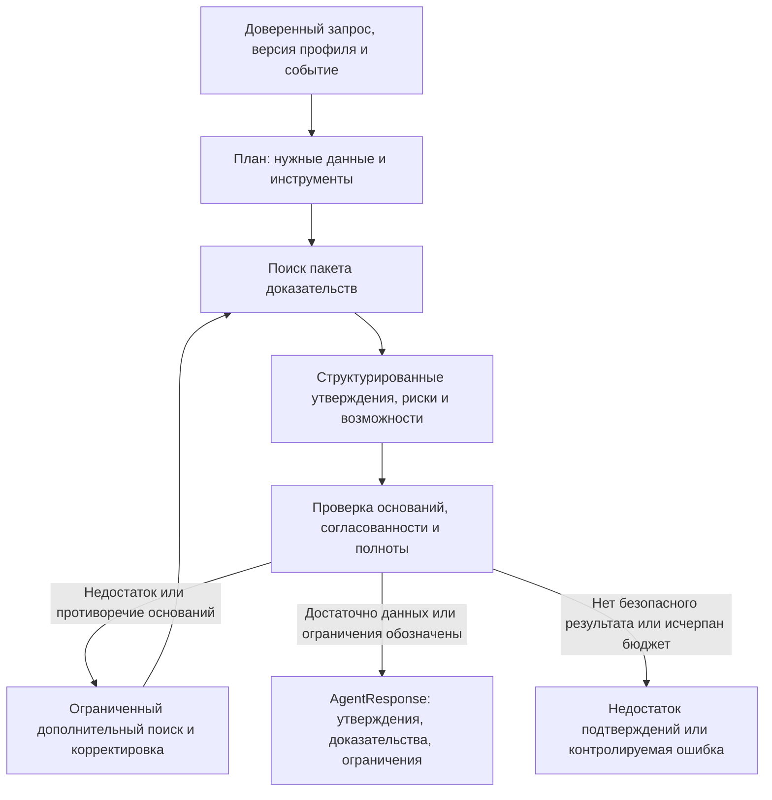

# Проектирование ML v0.1

ML-часть превращает данные о бизнесе и событиях в персональные выводы с проверяемыми основаниями. Она включает три направления: подготовку контекста и поиск (ML1), агент и генерацию (ML2), инфраструктуру выполнения и интеграцию (ML3). ML-сервис использует Python, FastAPI и Pydantic; обмен с сервером идёт по HTTP/JSON. Сущности и версии описаны в [модели данных](../architecture/data-model.md).

## ML1: анализ бизнеса, индекс и поиск

ML1 отвечает за исследование клиентских данных (EDA), бизнес-профиль `CompanyProfile`, граф связей, качество текста, чанки, embeddings, поиск, ранжирование и пакет доказательств `EvidencePackage`. Его результат должен быть пригоден для двух задач: объяснить отбор события в ленте и передать агенту конкретные основания подробного разбора.

Исследование клиентских данных должно проверить ключи, дубликаты и связность, пропуски и распределения, смысл категорий и градаций, единицы, валюту и период платежей, направление плательщик → получатель, состав групп, неизвестных участников связей, банковские продукты и данные ФТС. Место регистрации не считается географией операций. Наличие кредита не определяет сумму долга или тип ставки. Страна из ФТС не даёт точную величину зависимости от неё. Совпадение физического лица не доказывает принадлежность к группе или собственность без исходного подтверждения.

Профиль строится заранее: импорт → версия исходных данных → проверенные признаки → профиль компании → объединение группы со ссылками на вклад участников → сохранённый профиль. Новая поставка данных запускает управляемое обновление или перестроение. Профиль хранит пробелы и происхождение, а не заполняет неизвестное правдоподобным текстом.

Граф позволяет исследовать значимость контрагента, концентрацию платежей, направленные зависимости и косвенное влияние стран или отраслей. Для каждого показателя сохраняются исходная предпосылка, расчёт и ограничения. Затем ранжирование сравнивается с признаком и без него, а эксперт проверяет содержательность улучшения.

Представление графом не требует отдельной графовой БД. Простые показатели и сложные методы, включая GNN, PageRank и кластеризацию сообществ, оцениваются по одинаковому принципу: измеримая польза, корректность предпосылок, стоимость и объяснимость.

Обработка материала получает `NormalizedArticle` и безопасные метаданные источника от Go-воркера через аутентифицированный внутренний ML API. ML1 проверяет качество, создаёт чанки и embeddings. После готовности версии ML2 извлекает факты, ищет подходящие события, выполняет смысловую дедупликацию и сохраняет версии, источники и противоречия. Извлечённые данные проверяются; смысловое объединение сохраняет все версии публикаций и позволяет обнаружить ошибочное объединение. Сходство тем не означает одно событие. Обработка развивающихся сюжетов — развитие следующих версий.

## Эксперименты с поиском и ранжированием

Лексический поиск, включая BM25, поиск по векторам, гибридный подход и переранжирование сравниваются на одном корпусе и размеченных запросах. Для сравнения фиксируются модель, способ разбиения на фрагменты, перекрытие, K, веса, фильтры и пороги. Это позволяет отделить вклад метода от изменения данных или настроек.

Поиск для ленты оценивает значимость событий, а поиск доказательств возвращает конкретные цитируемые фрагменты. Удачный поиск похожего текста не гарантирует качественного бизнес-вывода; оценка должна включать обе задачи.

Единица запроса: бизнес-контекст + версия профиля + доверенная роль + событие или смысл вопроса. Ранжирование ленты возвращает краткие карточки событий; поиск доказательств — конкретные цитируемые фрагменты и признаки. Смысловая близость не равна вероятности влияния. Предпочтение источников определяется классификацией и проверяемыми признаками, а не произвольным `reliability_score`.

Аналитика Альфы отдельно индексируется и отбирается как `ALFA_ANALYTICS`. Наличие позиции банка по любому событию не гарантируется. Поиск собирает поддержку, противоречия и контекст; отсутствие банковских материалов отмечается как пробел. Устаревший прогноз не выдаётся за текущую позицию без даты и оговорки.

Пакет `EvidencePackage` содержит `package_id`, доверенный `request_context`, `primary_event_id`, `supporting_event_ids`, доказательства и ограничения. `request_context` связывает запрос и `trace_id` с пользователем, бизнес-контекстом, `role_id` и точной версией профиля. Отбор кандидатов и ранжирование определяют состав пакета; сведения о стадиях и оценках доступны через связанную трассировку.

Доказательство из новости ссылается на версию материала и фрагмент, из данных компании — на признак и его происхождение. ML2 не зависит от адаптера конкретного издателя. Внутренние оценки сопровождаются методом и версией конфигурации и не превращаются в необоснованный публичный процент уверенности.

## ML2: агент и генерация

Управляющий агент координирует инструменты: строит план, получает сведения, сохраняет контекст, формирует ответ, проверяет его и при необходимости уточняет данные. Оркестрация реализуется командой; готовая автономная платформа не является основой решения. Число агентов само по себе не повышает качество — важны наблюдаемые шаги и их результат.

Инструменты принимают структурированные параметры и возвращают данные с происхождением. Их права и контекст задаёт система, а не текст, созданный моделью:

| Инструмент | Вход / выход | Ограничения |
|---|---|---|
| `get_company_context` | Доверенный контекст и ссылка на профиль → признаки, пробелы и происхождение | Только чтение, фиксированный контекст; не принимает произвольную роль от модели |
| `get_business_relations` | Ссылка на профиль и разрешённый запрос признаков → проверенные связи | Связь с физлицом не считается правом доступа |
| `search_news` | Смысл запроса и разрешённые фильтры материалов → цитируемые внешние доказательства | Не произвольный просмотр интернета при каждом пользовательском запросе |
| `search_alfa_analytics` | Смысл запроса → датированные доказательства ALFA_ANALYTICS | Не создаёт позицию банка при её отсутствии |
| `get_event_evidence` | Ссылка на событие → версии фактов, материалов и противоречий | Сохраняет происхождение; объединённое резюме не считается первоисточником |

Контекст выполнения содержит неизменяемые ссылки, использованные доказательства, структурированные промежуточные результаты и ограничения. Текст новости или пользовательского сообщения не может расширить доступ агента и набор разрешённых инструментов. Сохранённая трассировка отражает наблюдаемые действия и результаты, без скрытых рассуждений модели.

Проверка охватывает схему ответа, существенные утверждения, применимость доказательств, приписывание позиции банку, числа и даты, согласованность рисков и действий, связь с профилем и отсутствие неподтверждённых сведений. Проверяющий компонент оценивается на размеченных примерах: правила и проверки разрешённой LLM сравниваются по пропускам ошибок и ложным отклонениям. Второй вызов LLM сам по себе не является независимым доказательством.

`SUPPORTED` допускается к использованию; `PARTIALLY_SUPPORTED` требует оговорки, допущения или нового поиска; `UNSUPPORTED` нельзя выдавать как факт. Условный прогноз имеет основания, но не гарантирован. Цикл ограничен числом попыток, временем и резервом токенов и стоимости. При исчерпании лимита агент возвращает ограничения или контролируемую ошибку, без бесконечных повторов.

Проверка не должна сводиться к наличию ссылки. Например, сведения о кредитном продукте подтверждают его наличие, но не сумму долга и не изменение платежа. Вывод о последствиях должен отделять известные предпосылки от условий, которые требуют дополнительных данных.

Результат ML передаётся во внутреннем `AnalysisResponse v1` с утверждениями, основаниями, ограничениями и версиями конфигурации. Go проверяет и сохраняет его, затем формирует публичный `AgentResponse` с разделами и ссылками на доказательства. Основное событие, контекст, роль и версия профиля фиксируются в окружающем ресурсе `Insight`; состояние выполнения относится к операции генерации.

Риски, возможности и действия представлены связанными разделами и утверждениями, а не независимыми текстами с разными основаниями. Полный разбор и уточняющий ответ используют одинаковую структуру `Claim` и `Evidence`, поэтому происхождение можно проверить в обоих сценариях.

## Уточняющий диалог

Диалог `Conversation` связан с разбором, пользователем, контекстом и ролью; история сохраняется. Сервер загружает доверенные ссылки, ML2 получает разбор, разрешённую историю и вопрос. Полная сохранённая история отличается от контекста конкретного вызова LLM: при длинном диалоге передаются значимые сообщения и краткое изложение с сохранением оснований. Размер определяется контекстом модели и бюджетом, без потери ссылок на существенные выводы.

Агент сначала определяет, относится ли вопрос к текущему разбору. Связанный иной ракурс допускается; произвольный новый бизнес-контекст или несвязанная новость не подменяют исходную сущность. Недостающие данные запрашиваются инструментами; новый ответ содержит собственные ссылки на утверждения, доказательства и трассировку, сохраняя прежний ответ. Ошибка генерации не создаёт видимость готового сообщения помощника.

## ML3: платформа и интеграция

ML3 отвечает за внутренний HTTP/OpenAPI, приём материалов от Go, шлюз LLM, повторы ML-вызовов, время ожидания и ограничения частоты, сохранение ML-трассировки и метрик, Docker, состояние, конфигурацию и тесты Go ↔ ML. Реестр источников, планировщик, адаптеры загрузки, воркер и пользовательские сессии находятся в Go. Инфраструктура индекса следует тем же правилам: наблюдаемое выполнение, версионирование и восстановление.

Все внутренние запросы требуют `Authorization: Bearer <SERVICE_TOKEN>` из окружения или хранилища секретов. ML принимает пользовательский контекст только от аутентифицированного Go, проверяет соответствие профиля, контекста, разбора и диалога и не обслуживает прямые запросы интерфейса. Токен не является JWT и не попадает в логи или ответы.

Для анализа и уточнения Go передаёт стабильный идентификатор своей операции как обязательный `Idempotency-Key`. ML сохраняет идентификатор, отпечаток вычислительных параметров и состояние до платного вызова; технические поля `trace_id` и `request_id` не меняют идентичность операции. Повтор возвращает существующее выполнение или результат; другой запрос с тем же ключом отклоняется с `409`. Неизвестный исход вызова провайдера не разрешает автоматически повторить оплачиваемую генерацию.

Шлюз проверяет разрешённый перечень моделей, их идентификаторы, поддержку структурированных ответов, бюджет и метаданные каждого вызова; фиксирует токены и стоимость, если провайдер их предоставляет. Дневной лимит 500 ₽ общий: локальный учёт не гарантирует остаток других участников без общей статистики провайдера. Нужны ограничения провайдера и командная координация бюджета; тарифы и границу сброса лимита необходимо уточнить. Классификация и краткие карточки не должны расходовать весь бюджет подробного анализа. Модель для задачи выбирается после измерений, не по предполагаемой силе названия.

## Разрешённые LLM

Список из PDF, без утверждений о доступности или качестве:

1. Gemma 4 26B A4B.
2. GLM-5.3-Flash.
3. Qwen3.6 35B A3B.
4. DeepSeek-V4.1-Flash.
5. Qwen3-VL-30B-A3B-Instruct.
6. Kimi-K2.6.

Шлюз использует реальные идентификаторы моделей провайдера и проверяет поддержку контекста, инструментов и структурированного JSON. Модели векторизации и переранжирования также проверяются на допустимость в рамках кейса. Качество, задержка и стоимость каждой задачи измеряются на сопоставимых примерах; название модели не заменяет проверку её возможностей. Другие LLM и внешний автономный сервис не используются как основной компонент.

## План оценки качества

Оценка разделяет три причины ошибки: система могла не найти материал, неверно связать его с бизнесом или неправильно сформулировать вывод. Поэтому единый итоговый балл дополняется показателями поиска, персонализации, подтверждённости и эксплуатации. Сравнение выполняется на зафиксированных версиях данных и конфигурации.

Версионируемые строки оценки содержат запрос, ссылки на контекст, роль и профиль, событие и набор материалов, градуированную релевантность, ожидаемую поддержку источниками и признаками, оценку высокого влияния и заметки разметчика. Примеры обучения и настройки отделены от отложенных событий и дубликатов публикаций. Материалы одного события не должны попадать в разные части выборки; разделение по времени и зафиксированная версия данных позволяют честно проверить новые новости.

| Эксперимент | Метрика / решение |
|---|---|
| Лексический, векторный, гибридный поиск и переранжирование | Recall@K/NDCG@K/MRR, p95 задержки и стоимость; основная метрика и K указываются в протоколе измерения |
| Сравнение персонализации с ролью и контекстом и без них | Изменение экспертной релевантности, правильность объяснения с учётом роли |
| Компания, группа и признаки графа | Улучшение относительно варианта без графа, покрытие происхождением данных, ложные утверждения о зависимостях |
| Сравнение с поиском аналитики Альфы и без него | Правильность приписывания банку, покрытие доказательствами, влияние на интерпретацию |
| Варианты генерации и проверки | Подтверждённость утверждений, фактические ошибки, глубина персонализации, надёжность структурированного ответа, задержки и токены |
| Неполные, противоречивые и зашумлённые данные | Корректность ограничений, успех дополнительного поиска, доля неподтверждённых утверждений |
| Дубли источников и изменение документа | Качество объединения событий, стабильность цитат и версий |

Результаты содержат версии данных, конфигурации и модели, а также размер выборки. Доля кликов (CTR) и обратная связь не заменяют разметку; небольшая демонстрационная выборка не доказывает качество и производительность при эксплуатации. Подробности — [демонстрация и оценка](../demo/demo-evaluation.md).
