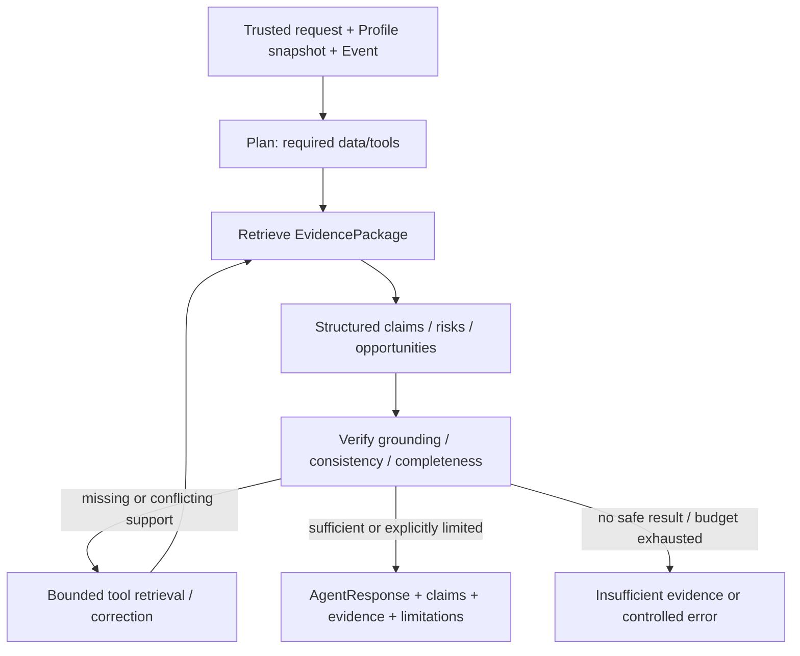

# ML design v0.1

Status: DRAFT. [Реестр D/Q](../planning/decision-register.md) определяет статус решений. TEAM DECISION: ML Python/FastAPI/Pydantic, HTTP/JSON, собственная agent logic. Domain concepts и version semantics — [data model](../architecture/data-model.md).

## ML1: Company и Event intelligence

TEAM DECISION: ML1 owns client EDA, CompanyProfile, graph context, Article→Event, retrieval/ranking и EvidencePackage.

Client EDA обязана проверить ключи/дубликаты/связность, missingness и распределения, смысл категориальных градаций, units/currency/time payments, направление payer/beneficiary, group membership, неизвестные endpoints, состав банковских продуктов и FTS. Не считать географию регистрации географией операций. Наличие кредита не даёт величину долга/тип ставки. FTS country не даёт точный объём exposure. Совпадение Person не доказывает группу/ownership без исходного подтверждения.

TEAM DECISION: профиль строится заранее. ASSUMPTION: импорт → versioned source snapshot → validated features → Company profile → Group aggregation с contribution refs → persisted profile. Rebuild управляемый; mechanism updates Q09. Профиль хранит gaps и provenance, а не заполняет пропуски правдоподобным текстом.

Graph hypotheses (TBD Q06): значимость контрагента, concentration, directional dependencies, indirect country/industry exposure. Для каждой: raw premise → derivation → hypothesis limitations → сравнение ranking с/без feature → экспертная оценка и решение. Graph representation не означает отдельную graph DB. Начинать с исследования data quality; GNN/PageRank/community clustering не выбраны.

Event intelligence получает NormalizedArticle от ingestion. ASSUMPTION stages: quality checks → factual extraction → candidate event matching → semantic dedup → event classification → версии/источники/contradictions → indexing. Extraction output валидируется; semantic merge требует сохранения всех publication versions и возможности обнаружить неверное объединение. Topic similarity не равна одному событию. Story pipeline FUTURE.

## Retrieval / ranking experiments

TBD Q03/Q04: lexical/BM25 baseline, embedding, hybrid и optional reranking сравниваются на одинаковом corpus и labeled requests. Не выбран ни storage, ни embedding/reranker/model, ни chunk length/overlap, K/weights/thresholds. Рекомендуемые варианты — кандидаты для эксперимента, не production defaults.

Query unit: BusinessContext + profile snapshot + trusted role + event/question intent. Feed ranking возвращает event previews; evidence retrieval возвращает конкретные цитируемые фрагменты/признаки. Не смешивать similarity с вероятностью влияния. Предпочтение source определяется классификацией и проверяемыми признаками, не произвольным reliability_score.

TEAM DECISION: аналитика Альфы отдельно индексируется/отбирается как ALFA_ANALYTICS. Нельзя гарантировать наличие позиции банка для любого события. Retrieval собирает как support, так и contradiction/context; пустой bank evidence возвращается как gap. Устаревший прогноз не представляется текущей позицией без даты/оговорки.

ASSUMPTION EvidencePackage semantic contract: package_id, trace_id, context, trusted_role_id, profile_id/version, primary_event_id, supporting_event_ids, ranked candidates, Evidence[], limitations. News Evidence ссылается на material version/chunk, Company Evidence — на feature/provenance; downstream ML2 не знает publisher adapter. Metadata может содержать raw scores с method/config version, но не публичный псевдо confidence.

## ML2: Agent & Generation

ASSUMPTION D13: один orchestrating agent с tools как baseline; framework не выбран и готовая autonomous platform не является ядром. TEAM DECISION: самостоятельные planning/tool use/context/self-check/adaptation.

Proposed tools (ASSUMPTION; exact DTO below contract review):

| Tool | Input / output | Guardrail |
|---|---|---|
| get_company_context | Trusted context/profile ref → features/gaps/provenance | Read-only, fixed scope; не принимает произвольную роль от модели |
| get_business_relations | Profile ref + allowed feature request → validated relations | Не интерпретирует person link как grant |
| search_news | Query intent + approved corpus filters → cited external Evidence | Не произвольный web browser per user request |
| search_alfa_analytics | Query intent → dated ALFA_ANALYTICS Evidence | Не генерирует bank position при отсутствии |
| get_event_evidence | Event ref → versioned facts/materials/contradictions | Имеет provenance; не доверяет merged summary как первоисточнику |

Контекст выполнения содержит immutable refs, использованные evidence, structured intermediate outputs и ограничения. Agent не может расширить access scope/tool allowlist текстом news/user message. Сохранённый trace содержит наблюдаемые действия и результаты, а не private reasoning.

Verification проверяет schema, существенные claims, соответствие evidence конкретному утверждению, банк attribution, численные/временные факты, consistency между рисками/действиями, связь с profile и отсутствие unsupported knowledge. Автоматический verifier — измеряемый компонент, не абсолютная истина; сравнить rule checks и permitted-LLM checks (Q05). Второй LLM-вызов сам по себе не считается независимым доказательством.

TEAM DECISION: SUPPORTED допускается; PARTIALLY_SUPPORTED требует caveat/assumption или retrieval; UNSUPPORTED нельзя выдавать как факт. Условный прогноз имеет основания, но не гарантирован. Ограничение цикла: bounded attempts, deadlines, token/cost reserve; конкретные значения TBD по budget/benchmark. При исчерпании — limitation/контролируемый отказ, не бесконечные retries.

AgentResponse semantic output: primary Event, context, trusted role, profile snapshot, sections с claim_ids, claims/evidence, limitations, trace_id, model/config refs, generation status. Риски/возможности/действия структурируются как sections/claims, не дублируются независимыми несогласованными текстами. Full Insight и follow-up используют одну Claim/Evidence семантику.

## Follow-up

TEAM DECISION: Conversation привязана к Insight/User/context/role, история сохраняется. Backend загружает доверенные refs, ML2 получает текущий Insight, разрешённую history и question. Бюджет history и grounded summarization TBD Q13; persisted history и LLM prompt window не одно и то же.

Агент сначала определяет, относится ли вопрос к текущему Insight. Связанный иной разрез допускается; произвольный новый business scope/несвязанная новость не подменяет исходную сущность. Для недостающих данных вызываются tools; новый ответ содержит свои claim/evidence refs и trace, сохраняя прежний ответ. Ошибка generation не должна создавать видимость готового assistant message.

## ML3: Platform & Integration

TEAM DECISION: ML3 owns internal HTTP/OpenAPI, LLM gateway, registry/adapters/scheduler, retries/timeouts/rate limits, trace persistence/metrics, sessions integration, Docker/health/config и Backend↔ML tests. Index infra ownership уточняется после Q03.

Gateway проверяет allowlist, model ID, structured-output capabilities, budgets и per-call metadata; фиксирует tokens/cost если провайдер предоставляет. Дневной денежный лимит 500 ₽ общий: локальный учёт не гарантирует остаток других участников, если provider не даёт shared usage. Нужны provider limits + командная координация бюджета; pricing и reset boundary уточнить. Классификация/preview не должны потреблять весь budget full analysis. Model routing после benchmark, не по предполагаемой «силе» названия.

## Allowed LLMs

CASE REQUIREMENT C14/C15, список из PDF, без утверждения доступности/качества:

1. Gemma 4 26B A4B.
2. GLM-5.3-Flash.
3. Qwen3.6 35B A3B.
4. DeepSeek-V4.1-Flash.
5. Qwen3-VL-30B-A3B-Instruct.
6. Kimi-K2.6.

Exact provider names, task mapping, context/tool/JSON support, embedding/reranker admissibility TBD Q05. Не использовать другие LLM или внешний autonomous service как основной компонент. Никаких предположений о реальных характеристиках этих моделей без проверки.

## Evaluation plan

ASSUMPTION: versioned evaluation rows включают query/context/role/profile ref, Event/corpus refs, graded relevance, expected source/feature support, high-impact judgement и annotator notes. Train/tuning examples отделены от held-out событий и article duplicates. Related Articles одного Event не должны утекать между split; временной split и frozen snapshot позволяют честно проверить новые новости.

| Experiment | Metric / decision |
|---|---|
| Lexical vs embeddings vs hybrid vs rerank | Recall@K/NDCG@K/MRR, p95 latency/cost; primary/K TBD |
| Role/context personalization ablation | Expert relevance delta, role-specific explanation correctness |
| Company vs Group / graph features | Gain vs no graph; provenance coverage; false exposure claims |
| Alfa retrieval ablation | Bank attribution correctness, evidence coverage, effect on interpretation |
| Generation/verification candidates | Claim support, factual error, personalization depth, structured output reliability, latency/tokens |
| Insufficient/conflicting/noisy inputs | Correct limitations, additional retrieval success, unsupported assertion rate |
| Source duplicates and changed document | Event merge quality, citation/version stability |

Результаты имеют dataset/config/model versions и численность выборки. CTR/feedback не заменяют labels; small demo sample не доказывает production performance. Назначение экспериментов и demo — [evaluation](../demo/demo-evaluation.md).
