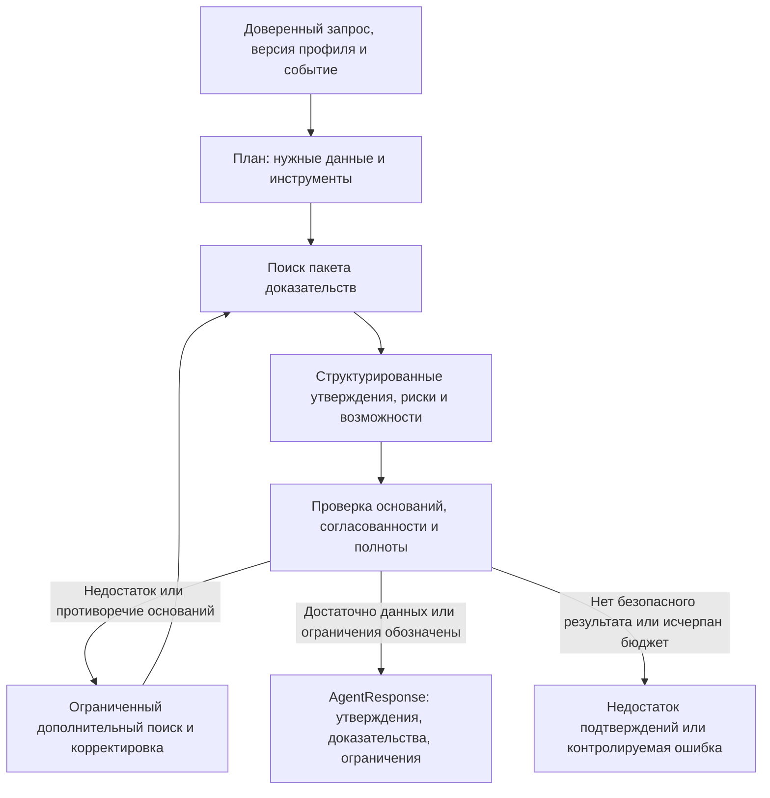

# Проектирование ML v0.1

Статус: DRAFT. Статусы решений определяет [реестр D/Q](../planning/decision-register.md). TEAM DECISION: Python/FastAPI/Pydantic для ML, HTTP/JSON, собственная агентная логика. Смысл сущностей и версий описан в [модели данных](../architecture/data-model.md).

## ML1: анализ бизнеса и обработка событий

TEAM DECISION: ML1 отвечает за исследование клиентских данных (EDA), бизнес-профиль `CompanyProfile`, граф связей, преобразование публикаций в события, поиск, ранжирование и пакет доказательств `EvidencePackage`.

Исследование клиентских данных должно проверить ключи, дубликаты и связность, пропуски и распределения, смысл категорий и градаций, единицы, валюту и период платежей, направление плательщик → получатель, состав групп, неизвестных участников связей, банковские продукты и данные ФТС. Место регистрации не считается географией операций. Наличие кредита не определяет сумму долга или тип ставки. Страна из ФТС не даёт точную величину зависимости от неё. Совпадение физического лица не доказывает принадлежность к группе или собственность без исходного подтверждения.

TEAM DECISION: профиль строится заранее. ASSUMPTION: импорт → версия исходных данных → проверенные признаки → профиль компании → объединение группы со ссылками на вклад участников → сохранённый профиль. Перестроение управляемое; способ получения обновлений — Q09. Профиль хранит пробелы и происхождение признаков, не заменяя пропуски правдоподобным текстом.

Гипотезы по графу (TBD Q06): значимость контрагента, концентрация, направленные зависимости и косвенное влияние стран или отраслей. Для каждой гипотезы: исходная предпосылка → расчёт → ограничения → сравнение ранжирования с признаком и без него → экспертная оценка и решение. Представление связей графом не требует отдельной графовой БД. Сначала исследуется качество данных; GNN, PageRank и кластеризация сообществ не выбраны.

Обработка событий получает `NormalizedArticle` от загрузчика. ASSUMPTION: проверка качества → извлечение фактов → поиск подходящих событий → смысловая дедупликация → классификация → версии, источники и противоречия → индексирование. Извлечённые данные проверяются; смысловое объединение сохраняет все версии публикаций и позволяет обнаружить ошибочное объединение. Сходство тем не означает одно событие. Обработка развивающихся сюжетов — FUTURE.

## Эксперименты с поиском и ранжированием

TBD Q03/Q04: базовый лексический поиск, включая BM25, поиск по векторам, гибридный поиск и дополнительное переранжирование сравниваются на одном наборе материалов и размеченных запросов. Не выбраны хранилище, модели векторизации и переранжирования, размер и перекрытие фрагментов, K, веса и пороги. Перечисленные варианты — кандидаты для экспериментов, а не настройки готовой системы.

Единица запроса: бизнес-контекст + версия профиля + доверенная роль + событие или смысл вопроса. Ранжирование ленты возвращает краткие карточки событий; поиск доказательств — конкретные цитируемые фрагменты и признаки. Смысловая близость не равна вероятности влияния. Предпочтение источников определяется классификацией и проверяемыми признаками, а не произвольным `reliability_score`.

TEAM DECISION: аналитика Альфы отдельно индексируется и отбирается как `ALFA_ANALYTICS`. Наличие позиции банка по любому событию не гарантируется. Поиск собирает поддержку, противоречия и контекст; отсутствие банковских материалов отмечается как пробел. Устаревший прогноз не выдаётся за текущую позицию без даты и оговорки.

ASSUMPTION: смысловой контракт `EvidencePackage` содержит `package_id`, `trace_id`, контекст, доверенную роль (`trusted_role_id`), `profile_id`/версию, `primary_event_id`, `supporting_event_ids`, ранжированных кандидатов, `Evidence[]` и ограничения. Доказательство из новости ссылается на версию материала и фрагмент, из данных компании — на признак и его происхождение. ML2 не зависит от адаптера конкретного издателя. Метаданные могут содержать внутренние оценки с версией метода и конфигурации, но не публичный необоснованный процент уверенности.

## ML2: агент и генерация

ASSUMPTION D13: исходный вариант — один управляющий агент с инструментами. Фреймворк не выбран; готовая автономная платформа не является основой решения. TEAM DECISION: самостоятельное планирование, вызов инструментов, сохранение контекста, самопроверка и адаптация.

Предлагаемые инструменты — ASSUMPTION; точные DTO требуют согласования контракта:

| Инструмент | Вход / выход | Ограничения |
|---|---|---|
| `get_company_context` | Доверенный контекст и ссылка на профиль → признаки, пробелы и происхождение | Только чтение, фиксированный контекст; не принимает произвольную роль от модели |
| `get_business_relations` | Ссылка на профиль и разрешённый запрос признаков → проверенные связи | Связь с физлицом не считается правом доступа |
| `search_news` | Смысл запроса и разрешённые фильтры материалов → цитируемые внешние доказательства | Не произвольный просмотр интернета при каждом пользовательском запросе |
| `search_alfa_analytics` | Смысл запроса → датированные доказательства ALFA_ANALYTICS | Не создаёт позицию банка при её отсутствии |
| `get_event_evidence` | Ссылка на событие → версии фактов, материалов и противоречий | Сохраняет происхождение; объединённое резюме не считается первоисточником |

Контекст выполнения содержит неизменяемые ссылки, использованные доказательства, структурированные промежуточные результаты и ограничения. Текст новости или пользовательского сообщения не может расширить доступ агента и набор разрешённых инструментов. Сохранённая трассировка отражает наблюдаемые действия и результаты, без скрытых рассуждений модели.

Проверка охватывает схему ответа, существенные утверждения, применимость доказательств к конкретному утверждению, корректность приписывания позиции банку, числа и даты, согласованность рисков и действий, связь с профилем и отсутствие неподтверждённых сведений. Автоматическая проверка — компонент с измеряемым качеством, а не абсолютная истина; требуется сравнить правила и проверки разрешённой LLM (Q05). Второй вызов LLM сам по себе не является независимым доказательством.

TEAM DECISION: `SUPPORTED` допускается; `PARTIALLY_SUPPORTED` требует оговорки, допущения или нового поиска; `UNSUPPORTED` нельзя выдавать как факт. Условный прогноз имеет основания, но не гарантирован. Цикл ограничен числом попыток, временем и резервом токенов и стоимости; значения TBD по бюджету и измерениям. При исчерпании — ограничение или контролируемый отказ, без бесконечных повторов.

Смысловой результат `AgentResponse`: основное событие, контекст, доверенная роль, версия профиля, разделы с `claim_ids`, утверждения и доказательства, ограничения, `trace_id`, ссылки на модель и конфигурацию, состояние генерации. Риски, возможности и действия представлены разделами и утверждениями, а не независимыми несогласованными текстами. Полный разбор и уточняющий ответ используют одинаковый смысл `Claim` и `Evidence`.

## Уточняющий диалог

TEAM DECISION: диалог `Conversation` связан с разбором, пользователем, контекстом и ролью; история сохраняется. Сервер загружает доверенные ссылки, ML2 получает текущий разбор, разрешённую историю и вопрос. Объём истории и её сокращение с сохранением оснований — TBD Q13; сохранённая история и фактический контекст запроса к LLM не одно и то же.

Агент сначала определяет, относится ли вопрос к текущему разбору. Связанный иной ракурс допускается; произвольный новый бизнес-контекст или несвязанная новость не подменяют исходную сущность. Недостающие данные запрашиваются инструментами; новый ответ содержит собственные ссылки на утверждения, доказательства и трассировку, сохраняя прежний ответ. Ошибка генерации не создаёт видимость готового сообщения помощника.

## ML3: платформа и интеграция

TEAM DECISION: ML3 отвечает за внутренний HTTP/OpenAPI, шлюз LLM, реестр, адаптеры и планировщик, повторы, время ожидания и ограничения частоты вызовов, сохранение трассировки и метрик, взаимодействие с сессиями, Docker, состояние, конфигурацию и тесты сервер ↔ ML. Владелец инфраструктуры индекса уточняется после Q03.

Шлюз проверяет разрешённый перечень моделей, их идентификаторы, поддержку структурированных ответов, бюджет и метаданные каждого вызова; фиксирует токены и стоимость, если провайдер их предоставляет. Дневной лимит 500 ₽ общий: локальный учёт не гарантирует остаток других участников без общей статистики провайдера. Нужны ограничения провайдера и командная координация бюджета; тарифы и границу сброса лимита необходимо уточнить. Классификация и краткие карточки не должны расходовать весь бюджет подробного анализа. Модель для задачи выбирается после измерений, не по предполагаемой силе названия.

## Разрешённые LLM

CASE REQUIREMENT C14/C15: список из PDF, без утверждений о доступности или качестве:

1. Gemma 4 26B A4B.
2. GLM-5.3-Flash.
3. Qwen3.6 35B A3B.
4. DeepSeek-V4.1-Flash.
5. Qwen3-VL-30B-A3B-Instruct.
6. Kimi-K2.6.

Точные идентификаторы провайдера, распределение задач по моделям, поддержка контекста, инструментов и JSON, допустимость моделей векторизации и переранжирования — TBD Q05. Другие LLM или внешний автономный сервис не используются как основной компонент. Реальные характеристики моделей требуют проверки.

## План оценки качества

ASSUMPTION: версионируемые строки оценки содержат запрос, ссылки на контекст, роль и профиль, событие и набор материалов, градуированную релевантность, ожидаемую поддержку источниками и признаками, оценку высокого влияния и заметки разметчика. Примеры обучения и настройки отделены от отложенных событий и дубликатов публикаций. Материалы одного события не должны попадать в разные части выборки; разделение по времени и зафиксированная версия данных позволяют честно проверить новые новости.

| Эксперимент | Метрика / решение |
|---|---|
| Лексический, векторный, гибридный поиск и переранжирование | Recall@K/NDCG@K/MRR, p95 задержки и стоимость; основная метрика и K — TBD |
| Сравнение персонализации с ролью и контекстом и без них | Изменение экспертной релевантности, правильность объяснения с учётом роли |
| Компания, группа и признаки графа | Улучшение относительно варианта без графа, покрытие происхождением данных, ложные утверждения о зависимостях |
| Сравнение с поиском аналитики Альфы и без него | Правильность приписывания банку, покрытие доказательствами, влияние на интерпретацию |
| Варианты генерации и проверки | Подтверждённость утверждений, фактические ошибки, глубина персонализации, надёжность структурированного ответа, задержки и токены |
| Неполные, противоречивые и зашумлённые данные | Корректность ограничений, успех дополнительного поиска, доля неподтверждённых утверждений |
| Дубли источников и изменение документа | Качество объединения событий, стабильность цитат и версий |

Результаты содержат версии данных, конфигурации и модели, а также размер выборки. Доля кликов (CTR) и обратная связь не заменяют разметку; небольшая демонстрационная выборка не доказывает качество и производительность при эксплуатации. Подробности — [демонстрация и оценка](../demo/demo-evaluation.md).
