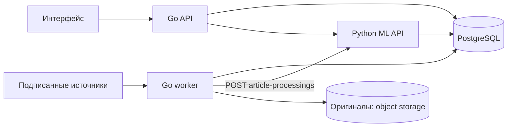

# RFC 0003: архитектура бэкенда и загрузки источников

**Статус:** предложение для обсуждения

**Дата:** 2026-10-22

**Область:** внешний API, асинхронная загрузка источников, хранение публикаций, взаимодействие с ML

**Уточнение контракта Go → ML для прототипа:** 2026-10-23

## Контекст и решение

Продукту нужны проверенные новости и материалы Альфа-Банка, персональный анализ по запросу и точные ссылки на версии доказательств. Подписанный источник в общем случае — URL страницы, ленты, API или документа. Обращение к нему во время пользовательского запроса даёт непредсказуемую задержку и делает ответ зависимым от доступности чужого сайта.

Предлагается **один Go-кодовый модуль с двумя независимо запускаемыми процессами**: `api` обслуживает запросы, `worker` по расписанию загружает и нормализует материалы. Оба используют PostgreSQL. Python ML-сервис получает уже сохранённые версии материалов, строит события, индекс, доказательства и анализ. Он не опрашивает источники в пользовательском запросе. Go сохраняет новую версию и задание в PostgreSQL, затем воркер передаёт материал в ML через `POST /internal/v0.1/article-processings`. Отдельные Redis, Kafka и поисковая СУБД на старте не обязательны.

Разделение соответствует обновлённым [архитектуре](../architecture/architecture.md) и [описанию ingestion](../ingestion/source-ingestion.md): Go владеет загрузкой, ML — смысловой обработкой. RFC уточняет исполнение и хранение; его принятие не означает, что реализация уже готова.

## Цели и границы

- Пользовательский API не ждёт сеть издателя и парсинг сайта.
- Повторный опрос не создаёт дубликаты и не теряет данные после сбоя.
- Изменение известной статьи создаёт новую адресуемую версию, старые доказательства сохраняют исходную версию.
- Воркер можно масштабировать отдельно от API; источник с ошибкой не останавливает остальные.
- Хранение и удаление имеют правила по классам данных, а не один TTL для всей БД.

RFC не выбирает конкретную библиотеку Go, провайдера объектного хранилища, модель эмбеддингов и алгоритм смысловой дедупликации. RSS/Atom/API/HTML поддерживаются только через явно реализованные и проверенные адаптеры; произвольный URL не обещает успешный импорт.

## Компоненты и владение данными

| Компонент | Пишет | Читает / вызывает |
|---|---|---|
| Go API | пользователи, права, источники и их конфигурация, операции, `Insight`, диалоги, обратная связь | PostgreSQL; внутренний API ML |
| Go worker | запуски опроса, состояние загрузки, оригиналы, публикации и их версии, задания на обработку | реестр источников, сайты/API издателей, объектное хранилище при наличии |
| Python ML | события, индекс/эмбеддинги, пакеты доказательств, результаты анализа и трассировки своей обработки | `NormalizedArticle` и безопасные метаданные источника от Go; вызовы разрешённой модели |

У каждой таблицы или схемы есть владелец записи и миграций. Общая PostgreSQL не даёт сервису права менять чужие таблицы. Go извлекает текст из HTML/PDF и передаёт сохранённый `NormalizedArticle` и безопасные метаданные источника в ML по внутреннему HTTP API; ML не читает таблицы загрузки напрямую и не скачивает оригинал по `raw_ref`. В запрос не входят URL доступа к издателю, секреты и настройки адаптера. Для анализа изображений или исходной разметки PDF потребуется отдельное согласование.

Диаграмма показывает логический поток: запись новой версии и задания выполняется транзакционно в PostgreSQL; Go передаёт ML только сохранённую версию. Object storage подключается при необходимости хранить исходные байты и не является обязательным условием чтения текста.

## Опрос источника и отслеживание изменений

1. Go API создаёт `source` с типом адаптера, URL, интервалом, правами, классом доверия и версией конфигурации. Адрес и перенаправления проходят проверку против SSRF; секреты хранятся отдельно и в ответ не попадают.
2. Планировщик выбирает включённые источники с `next_poll_at <= now()` и без действующего lease. Для нескольких воркеров выбор выполняется короткой транзакцией с блокировкой строк и `FOR UPDATE SKIP LOCKED`; lease имеет срок и токен владельца, длительный опрос продлевает lease. Сетевой запрос выполняется **после** коммита выбора, без удержания транзакции.
3. Адаптер сначала использует официальный API/канал, затем RSS/Atom, затем поддерживаемый HTML-парсер. Для HTTP сохраняются `ETag` и `Last-Modified`; следующий запрос посылает условные заголовки. Ответ `304` означает отсутствие изменений у конкретного ресурса, но не доказывает полноту ленты. При ответе `200` содержимое проверяется независимо от этих заголовков.
4. Для ленты каждая запись идентифицируется по `(source_id, external_id)` или каноническому URL; для страницы без устойчивого ID — по каноническому URL в рамках источника. Перенаправления, tracking-параметры и правила канонизации версионируются. Время публикации берётся из источника, время обнаружения хранится отдельно.
5. Для известного материала рассчитывается хеш **нормализованного содержимого**: заголовок, основной текст и значимые метаданные в заданной канонической сериализации. Меню, реклама и динамические блоки исключаются адаптером. Хеш полного HTML можно хранить отдельно для диагностики; побайтовое изменение HTML само по себе не создаёт новую версию статьи. Изменение только шаблона сайта не должно запускать ML заново.
6. Если содержимое изменилось, создаётся неизменяемая `article_version` с `content_hash`, `parser_version`, `fetched_at`, `published_at`, текстом и ссылкой на оригинал. Статус ML-обработки хранится в задании для конкретной версии пайплайна. Изменение парсера при прежнем оригинале — отдельная повторная нормализация с новой версией представления; происхождение и причина версии сохраняются. Если хеш тот же, обновляются только состояние проверки и метаданные опроса.
7. В одной транзакции сохраняются новая версия, запись задания на последующую ML-обработку и курсор/состояние источника. Для постраничного импорта курсор продвигается после сохранения соответствующей порции, с перекрытием следующего чтения. Все записи результата опроса, включая `latest_version_id`, курсор и новые задания, допускаются только при действующем `lease_token` источника: условное обновление по токену и сроку lease выполняется в той же транзакции. Если оно не затронуло строку, вся транзакция откатывается; потерявший lease воркер не публикует запоздавший результат. При сбое до коммита курсор не продвигается. При повторе уникальные ограничения и ключ идемпотентности возвращают существующий результат.

Для одиночной страницы без RSS и API опрос фиксирует только состояние этой страницы. Обнаруживать новые URL на всём сайте можно лишь отдельным адаптером обхода с явно заданной областью и правилами. Если источник отдаёт ленту с ограниченным окном, воркер читает страницы до сохранённого курсора с допустимым перекрытием: один `304` на главной странице не заменяет проверки элементов ленты.

Неуспех одного опроса не удаляет ранее сохранённые материалы. `429` и временные сетевые ошибки дают ограниченный backoff с учётом `Retry-After`; постоянная ошибка конфигурации переводит источник в `DEGRADED`/`UNAVAILABLE` и требует исправления. Если исходная статья удалена издателем, это отмечается отдельно; доказательства из ранее сохранённой версии не переписываются.

## Минимальная физическая модель

Имена ниже ориентировочные; миграция задаёт точные типы и ограничения. Критичные для поиска и целостности поля — обычные колонки. `jsonb` подходит для редких метаданных конкретного адаптера, но не заменяет индексы, внешние ключи и проверяемые состояния.

| Сущность | Основные поля и инварианты |
|---|---|
| `sources` | `id`, `kind`, `adapter_type`, `url`, `enabled`, `poll_interval`, `next_poll_at`, `config_version`, `trust_class`, `health`, `lease_until`, `lease_token`; секрет — только ссылка |
| `source_polls` | `id`, `source_id`, `started_at`, `finished_at`, `status`, `http_status`, счётчики, очищенная ошибка; попытка видна отдельно от материала |
| `articles` | `id`, `source_id`, `external_id`, `canonical_url`, `first_seen_at`, `latest_version_id`; уникальность идентичности в рамках источника |
| `article_versions` | `id`, `article_id`, `version_no`, `content_hash`, `parser_version`, `title`, `body_text`, `published_at`, `fetched_at`, `raw_object_uri`, `raw_sha256`; версия неизменяема |
| `processing_jobs` | `id`, `kind`, `dedupe_key`, `payload_ref`, `pipeline_version`, `ml_processing_id`, `status`, `attempts`, `next_attempt_at`, `lease_until`, `lease_token`; уникальный `dedupe_key` для одной версии и обработки |

Уникальные ключи требуют точной семантики для источника без `external_id`: отдельные частичные ограничения или вычисленный `identity_key` с `NOT NULL`; простое `UNIQUE(source_id, external_id)` не защищает строки с `NULL`. Перевод `latest_version_id` на новую версию происходит после её сохранения. ML ссылается на `article_version.id`/`document_version_id`, а не только на URL или `articles.id`. Если выбран отдельный ID документа, отображение между ними однозначно и хранится.

Задания и данные записываются в одной транзакции (transactional outbox). Консьюмер выбирает задания с `FOR UPDATE SKIP LOCKED`, устанавливает lease и после коммита вызывает ML. ML задаёт идентификатор версии обработки; для прототипа Go и ML получают согласованное значение из окружения. Go фиксирует `pipeline_version` в задании до POST и передаёт её с `NormalizedArticle` и безопасными метаданными источника. Версия однозначно задаёт конфигурации ML1 для разбиения и индекса и ML2 для событий. ML сохраняет отображение `article_version_id → document_version_id` и версии обоих этапов; внутренний ключ ML2 — `(document_version_id, event_pipeline_config_version)`. ML отклоняет неподдерживаемую версию до запуска обработки. Повтор сохраняет исходную версию, даже если текущая конфигурация ML сменилась. Переобработка новой версией создаёт отдельное задание.

`Idempotency-Key` строится из `(article_version_id, pipeline_version)` и хранится с заданием. Go сохраняет снимок передаваемых значимых метаданных источника, включая `config_version`, вместе с заданием, чтобы после изменения реестра повторить исходный запрос. ML сравнивает содержимое материала и эти метаданные; `trace_id` не входит в отпечаток. Тот же ключ с другим значимым содержимым даёт `409`. Ответ `202` означает только сохранение и приём задания: Go сохраняет `processing_id` и опрашивает `GET /internal/v0.1/article-processings/{processing_id}` до `SUCCEEDED` или `FAILED`. Если первый ответ потерян, повторный POST с тем же ключом возвращает ту же операцию. При `404` на GET Go повторяет исходный POST с тем же ключом для восстановления ссылки; исчезновение уже подтверждённой операции после этой попытки требует разбирательства. Только `SUCCEEDED` с проверенными `article_version_id`, исходной `pipeline_version`, `document_version_id` и `event_ids` переводит материал в состояние «готово для поиска»: чанки и embeddings доступны, результат обработки событий сохранён; `event_ids` может быть пустым. ML обязан возвращать ту же `pipeline_version` в POST и GET, включая повторные запросы. `FAILED` сохраняется как ошибка. Обновление статуса задания допускается только владельцем действующего lease. Гарантия — **at least once**, не «ровно один вызов». Тот же механизм применим к долгой генерации `Insight`, но её состояния и ключи описаны отдельно в [RFC 0002](0002-insight-generation-lifecycle.md).

Неверный материал (`422`), превышение согласованного лимита текста (`413`), конфликт ключа (`409`) и неподдерживаемая версия пайплайна (`422`, отдельный код) не повторяются автоматически. Для `429`, временного `503` и сетевого сбоя Go делает ограниченные повторы с тем же ключом и учитывает `Retry-After`. Численный лимит текста и разрешённые поля `metadata` согласуются с ML1 до запуска воркера; пока `metadata` — пустой объект. Операции и ключи не удаляются во время хакатона. Граница Go → ML остаётся HTTP независимо от использования Kafka внутри сервисов.

В Go уникальность `(article_version_id, pipeline_version)` в `processing_jobs` и сохранённый `document_version_id` отделяют результаты разных запусков пайплайна. ML хранит свои фрагменты, события и доказательства с привязкой к `document_version_id` и версии пайплайна. Переобработка не перезаписывает результаты, на которые ссылается старый `Insight`.

## Хранилища, кэш и ретеншен

PostgreSQL достаточно для реестра, версий, операций, небольших оригиналов на раннем прототипе и очереди умеренной нагрузки. Нормализованный текст нужен в PostgreSQL, чтобы ML и API могли читать его без нового обращения к издателю. Оригинальные PDF/HTML — это исходные **байты файла**, а не «бинарные токены» модели: при росте объёма их целесообразно положить в закрытое S3-совместимое object storage, оставив в БД URI, SHA-256, размер, MIME-тип и происхождение. Векторы — отдельные числовые данные; выбор `pgvector` или иной реализации остаётся за [RFC 0001](0001-vector-storage.md). URI оригинала не должен быть публичным постоянным URL.

Стартовый кэш — условные HTTP-запросы к источнику, уникальные ключи версий, сохранённые результаты нормализации и идемпотентные задания. Для горячего чтения возможен небольшой локальный кэш с коротким TTL и явной инвалидацией; он не источник истины. Redis вводится, когда измерения покажут, что PostgreSQL/локальный кэш не выдерживают требуемую задержку или интенсивность заданий. Финальный персональный ответ нельзя безусловно кэшировать между пользователями.

Ретеншен задаётся отдельно для `source_polls`/телеметрии, оригиналов, нормализованных версий, заданий и пользовательских результатов. Для завершённых `source_polls` действует срок 30 дней по `created_at`: отдельный процесс удаляет их пачками по 1000 записей раз в сутки, предоставляет dry-run и метрику удалений. Сроки оригиналов, версий статей и результатов ML пока не установлены: сначала требуется согласовать зависимости доказательств и порядок удаления. Для `articles`, `article_versions`, `Evidence`, `Insight` удаление по одной дате опасно: старый разбор может ссылаться на старую версию. Если исходные байты в будущем будут удаляться раньше текста, схема должна позволить сохранить метаданные и хеш, а система должна явно показывать ограничение воспроизводимости.

Секционирование откладывается до замеров объёма и стоимости пакетного удаления. В PostgreSQL удаление секции обычно быстрее массового `DELETE`, но требует планирования блокировок и границ дат, а ключ секционирования придётся учесть в первичном ключе и внешних ссылках ([документация PostgreSQL](https://www.postgresql.org/docs/current/ddl-partitioning.html)).

## Нагрузка, безопасность и наблюдаемость

API и worker масштабируются независимо. Для источников действуют лимиты параллелизма глобально и по домену, таймауты, максимальный размер ответа, backoff и небольшой случайный сдвиг расписания. При росте числа источников можно увеличить число воркеров; при росте очереди сначала измеряются время ожидания, скорость обработки и нагрузка на PostgreSQL, затем решается вопрос об отдельном брокере. Тяжёлое извлечение PDF и ML-обработка выполняются вне HTTP-обработчика.

На каждом запросе к источнику проверяются схема, DNS/IP конечного адреса и **каждый** redirect; localhost, приватные сети и metadata endpoints запрещены. URL и HTML считаются недоверенным вводом. Доступ к административному API, оригиналам и доказательствам проверяется сервером. Инструкции внутри PDF/HTML не становятся инструкциями агенту. Секреты и тела материалов не попадают в обычные логи.

Минимальные метрики: lag опроса по источнику, доля успешных опросов, `304`/новые версии, время загрузки и нормализации, очередь и возраст старейшего задания, количество повторов, ошибки ML, размер БД/оригиналов, p95 внешнего API. `trace_id`, `source_id`, `poll_id`, `article_version_id`, `job_id` связывают этапы без записи чувствительных текстов. Система показывает отдельно «получено», «нормализовано», «обработано ML» и «готово для поиска».

## Этапы реализации и проверка

1. Зафиксировать владельцев таблиц и внутренний контракт `NormalizedArticle`; обновить архитектурные документы и API после решения по этому RFC.
2. Реализовать реестр источников, миграции, worker с одним RSS/Atom-адаптером, условные запросы, уникальные ключи и статус опроса. Для HTML добавить адаптеры только для выбранных сайтов и тестовые сохранённые страницы.
3. Добавить неизменяемые версии, хранение оригинала, транзакционную постановку задач и идемпотентную передачу ML; проверить падение до/после коммита и истечение lease.
4. Добавить управление ретеншеном по классам данных, метрики, алерты на отставание и ручной повтор/переобработку.
5. На измеренной нагрузке решить, нужны ли object storage, секции, выделенный брокер, Redis или отдельный поисковый движок.

Приёмка: повторный опрос неизменного материала не создаёт новую версию; изменение основного текста создаёт её; изменение меню страницы не создаёт; два воркера не публикуют два результата; после сбоя задача возобновляется; старый `Insight` показывает ту же версию доказательства; недоступный источник не замедляет пользовательский запрос; удаление по ретеншену не создаёт битые ссылки.

## Открытые решения перед реализацией

- Список конкретных стартовых источников, их форматы, правила использования материалов и частота опроса.
- Сроки хранения по классам данных и момент, после которого допустимо удалять доказательства и исходные файлы.
- Порог размера/объёма для выноса оригиналов в object storage и способ восстановления при расхождении БД и хранилища.
- Согласовать с ML1 численный лимит текста и список разрешённых полей `metadata` до запуска воркера.

## Ссылки

- [Архитектура проекта](../architecture/architecture.md), [загрузка источников](../ingestion/source-ingestion.md), [предметная модель](../architecture/data-model.md), [RFC 0002](0002-insight-generation-lifecycle.md).
- [PostgreSQL: `SELECT` и `SKIP LOCKED`](https://www.postgresql.org/docs/current/sql-select.html), [секционирование таблиц](https://www.postgresql.org/docs/current/ddl-partitioning.html).
